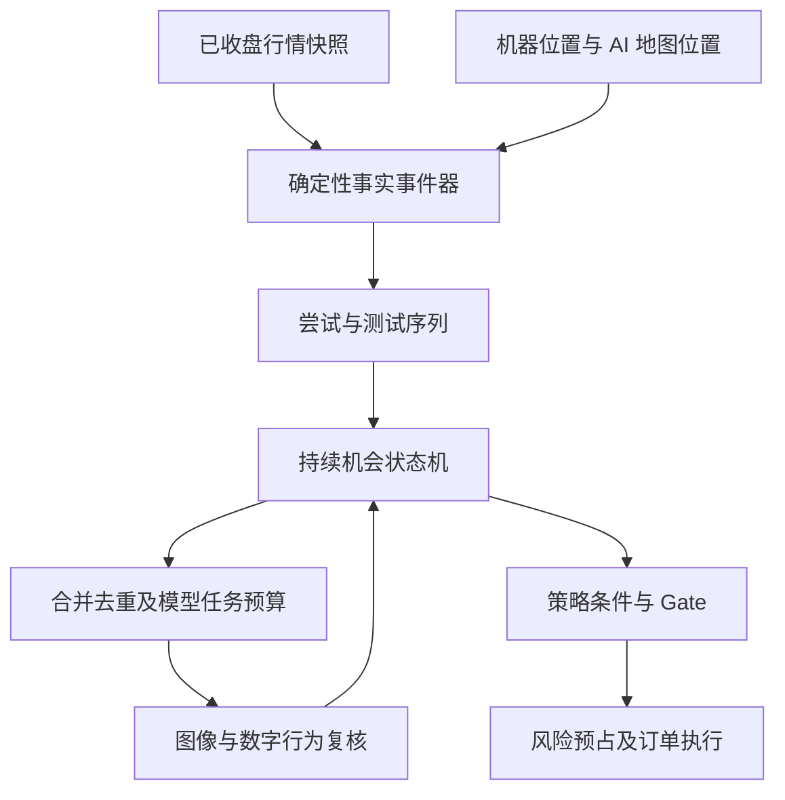

# 事件器设计 v1：追踪突破尝试及其后续结果

日期：2026-10-31。状态：待实现设计。依据已核验代码 50559aa 与《自动交易优化设计-v2.2.md》。本文件定义软件行为，不表示突破策略已被验证有效；不修改已有交易门槛，不授权实盘下单。

## 1. 要解决的问题

现有 build_events、build_gap_events、build_confirm_events 主要从机器识别的位置中筛选历史到达或确认时点。它们适合抽实验样本，但将位置识别、事实检测、策略确认及采样限制混在一起。在线自动交易需要持续回答：价格尝试越过什么位置，之后留在外面、收回、回测还是再次尝试？

事件器的中心是“突破尝试及其后续结果”，不是“识别出一个形态就交易”。三推、趋势、区间提供背景；高周期阻力、前高前低、MM 提供位置；越界、收回、回测提供事件；策略和 gate 决定是否允许交易。

事件器输出事实，不直接输出买卖建议，不把单根越界命名为有效突破。突破是主线而非统一必需条件：未越界的支撑拒绝、位置触及等仍可唤醒对应策略。

## 2. 职责边界

| 组件 | 负责 | 不负责 |
|---|---|---|
| 位置提供者 | 提供机器或 AI 提出的已存在位置及证据 | 确认未来突破一定有效 |
| 事件器 | 对固定位置检测越界、收回、离开、返回 | 判断三推质量、选择交易方向 |
| 序列跟踪器 | 关联同一次尝试及测试轮次 | 将固定根数等同于突破成功 |
| AI 行为判读 | 结合图像解释接受、失败、减弱和反证 | 随意移动位置或修改冻结必须项 |
| 机会状态机 | 保存证据、等待、触发、取消 | 把观察事件当成交 |
| gate 与执行器 | 位置资格、空间、预算、订单触发与成交 | 用结果盈利反推原判断正确 |

## 3. 运行链路



位置发现另有低频图读入口，避免“机器没识别出位置，AI 永远没有机会看见”。位置发现频率属于配置，不在事件器内硬编码。

首版输入仅使用已收盘 K 线。模型复核的时间粒度由该周期决定；盘中已挂 stop/limit 的触发由交易所处理。不能用收盘才生成的事件追认本根内的成交。

## 4. 位置契约

```text
WatchLevel
  level_id, level_version
  symbol, timeframe
  kind: resistance | support | neutral
  lo, hi                    # 原始位置边界，Decimal，lo <= hi
  watch_lo, watch_hi        # 已冻结观察带，必须覆盖 [lo, hi]
  source: machine | model | manual
  evidence_ids
  source_cutoff_at          # 位置所依据的信息边界
  available_at             # 系统实际获得该位置的时间
  valid_until              # 运营到期，可空；须有发布政策
  strategy_version
```

越界和收回使用原始 lo/hi；接近、测试和回测使用观察带 watch_lo/watch_hi。算法不得额外偷偷加容差。生成观察带的政策及参数必须留档。

突破方向表示价格越界方向，不等于下单方向。阻力上破可能关联顺势多头，也可能关联失败后的空头。

位置更新生成新版本；旧尝试不悄悄挂到新边界。旧版本如何取消、替换或继续观察由地图/机会管理决定。事件器不自动按浮动均幅重新编号或合并位置。

真实前向模式只对位置 available_at 之后开始的 K 线检测新尝试。首次加载时仅建立当前内外状态；已经在位外不补发历史突破。历史回放单独标模式，可重放但不能算真实前向。

## 5. 事实事件定义

以下以原始位置 [L,U]、观察带 [WL,WU] 表示，等于边界不算越界。所有比较使用未四舍五入的交易价格精度。

| 事件 | 确定性条件 | 含义边界 |
|---|---|---|
| ZONE_TOUCHED | low <= WU 且 high >= WL | 接触观察区域，不代表入场位置资格 |
| UPSIDE_ATTEMPT_STARTED | 无活跃上破尝试，前收盘 <= U，当前 high > U | 开始上破尝试，不代表收盘突破 |
| DOWNSIDE_ATTEMPT_STARTED | 无活跃下破尝试，前收盘 >= L，当前 low < L | 开始下破尝试 |
| CLOSE_OUTSIDE_UP | close > U | 收盘在上沿外，不代表被接受 |
| CLOSE_OUTSIDE_DOWN | close < L | 收盘在下沿外，不代表被接受 |
| UPSIDE_RECLAIMED | 活跃上破尝试，当前 close <= U | 上破后收回至上沿以内，也可能穿过整个区间 |
| DOWNSIDE_RECLAIMED | 活跃下破尝试，当前 close >= L | 下破后收回至下沿以内 |
| OUTSIDE_SEPARATED_UP | 活跃上破尝试，low > WU | 整根离开观察带并位于上方 |
| OUTSIDE_SEPARATED_DOWN | 活跃下破尝试，high < WL | 整根离开观察带并位于下方 |
| RETEST_STARTED | 已在突破侧完成 separated，后续 bar 再次触及观察带 | 回测开始，不代表守住或失守 |

close 类事实每根可记录；reclaimed 仅在首次从未收回状态变为收回时发出一次。事件 ID 去重，不通过丢弃后续 K 线降噪。

突破发生的同根可以同时发出 attempt、touch、reclaimed。例如 high > U 且 close <= U。这是事实集合，不是假定盘中先后路径；事件带同一 bar_id 和 intrabar_order_unknown=true。若同根上下两侧均越界，分别创建方向尝试并标 dual_sided=true，不能凭 OHLC 排出先突破哪边。

## 6. 尝试生命周期

每个 level_version × direction 同时最多一个活跃尝试。attempt_id 由位置版本、方向及首个突破 bar_id 确定。它不同于 opportunity_id：同一机会可以经历多次尝试，一次尝试也可为不同假设提供证据。

```text
无尝试 → STARTED → OUTSIDE_TRACKING → RETESTING
                  ↘ RECLAIMED
任一活跃状态 → SUPERSEDED / EXPIRED（运营终止）
```

状态只概括事实，证据事件追加保留：

1. 首次越界创建 STARTED；同根收回则直接记录 RECLAIMED，并保留开始事件。
2. 收盘在外进入 OUTSIDE_TRACKING；连续在外只更新事实，不不断创建新尝试。
3. 完成 separated 后返回观察带进入 RETESTING；同根若收回也记录 reclaimed，结果为 RECLAIMED。
4. RECLAIMED 结束该次突破尝试的跟踪，但不宣称策略上的失败已经确认；后续再次满足起始条件可创建新 attempt_id，并关联 previous_attempt_id。
5. 未收回但经历多次离开和回测，仍属同一次尝试，retest_sequence 递增。离开与返回不能使用同根。
6. 位置替代或运营到期终结尝试，不等于交易假设被价格证伪。

首次启动缺前一根时不检测跨越事件；禁止以“上一根默认为带内”创造突破。缺 K 线时停止跨缺口序列判定，输出 DATA_GAP，恢复规则由输入契约指定。

## 7. AI 应判什么

事件包包含：原始位置和观察带、突破起点、所有相关测试与收回 bar_ids、当前同边界图像、OHLC、冻结策略条件和反证。不能只给一根截图让模型猜背景。

AI 输出 BehaviorAssessment：

- interpretation：acceptance_candidate / failure_candidate / retest_holding_candidate / unresolved。
- 对每个冻结条件给 met / not_met / unknown，附证据引用。
- 背景证据：三推、趋势或区间、MM、高周期位置；缺数据就写未知。
- strongest_counterevidence、下一缺项及取消条件的引用。

上述 interpretation 只是解释标签，不直接驱动订单。必须项与否决项仍逐条核验。禁止把“连续两根位外”作为所有策略的统一接受定义，禁止仅因一次收回就宣布反转成立。

## 8. 与现有交易纪律衔接

P0–P2 保留 v2.2 的现行收盘位置资格：收盘位于地图点位带 ±0.25×段均幅内，才继续评估提交。事件器可以记录位外突破和收回证据，但不能绕过该检查。

这意味着部分位外延续机会在首版只能进入观察/研究记录。是否对特定突破策略采用新的位置资格，必须单列预注册实验及策略版本，不通过修改事件器暗中放宽。

非突破机会保留 ZONE_TOUCHED → 行为复核路径。例如支撑触及后反弹、未突破边界，也可以按对应策略等待触发；不能为了统一架构强制每笔交易先出现假突破。

确定性取消与已有订单风险处理优先于模型任务，预算用尽也不能暂停这些检查。

## 9. 去重、任务和计数

事件唯一键：level_version + bar_id + event_type + direction。消费幂等；同一快照的多个事件合并为一次机会复核任务，保留全部事件 ID。

三个计数独立：attempt_sequence（新的突破尝试）、retest_sequence（同尝试内离开后返回）、assessment_count（有效模型复核）。模型多看几次不能制造更多测试。

只有新起始、收回、回测、条件相关确定性事实变化，或仍有模型型缺项时新增收盘 K 线，才成为任务创建候选。任务按 v2.2 预算和并发限制处理；被限流事件持久化为 deferred，不删除事实。

研究采样的“每点一次、固定间隔、每段最多 N 个”留在 eval，不进入在线事件器。

## 10. 实现接口与迁移

```python
# 纯函数，不访问文件、模型或交易所。
detect_price_events(previous_bar, current_bar, level, attempt_state) -> tuple[PriceEvent, ...]
advance_attempt(attempt_state, events) -> AttemptTransition
build_behavior_input(opportunity, attempt_history, snapshot) -> BehaviorInput
```

PriceEvent 必含 event_id、level_id/version、attempt_id（无关联可空）、bar_id、event_time、observed_at、snapshot_id、direction、type、evidence、intrabar_order_unknown。attempt transition 与事件写入原子持久化，后续任务经 outbox 生成。

迁移顺序：

1. 从现有事件器提取位置触及公共计算，原实验入口和结果保持可复跑。
2. 新增本文件的事实事件及纯状态机测试，不改变 gate。
3. 接入机器和 AI 两类位置；真实前向严格检查 available_at。
4. 将事件接到 Opportunity；移除在线链的采样限额，保留任务预算。
5. 新旧事件器在同一冻结轨迹上影子比较，不直接切实盘。

不在本次迁移中重写要塞算法、增加策略卡、放宽入场纪律或建立盈利评分。

## 11. 可计算的验收案例

以原始区间与观察带均为 [100,102] 为测试夹具，非真实交易参数。

| 案例 | 输入 | 必须输出 |
|---|---|---|
| E01 上破收外 | 前 close=101；当前 O=101,H=104,L=101,C=103 | 上破开始、收外；没有“有效突破”结论 |
| E02 同根收回 | 前 close=101；当前 O=101,H=103,L=100.5,C=101.5 | 上破开始与收回，同根路径不明 |
| E03 连续位外 | 活跃上破；下一根 O=103,H=105,L=102.5,C=104 | 同 attempt，收外及 separated；无新尝试 |
| E04 返回守上沿 | E03 后 O=104,H=104,L=101.8,C=102.5 | RETEST_STARTED；没有直接入场决定 |
| E05 回测收回 | E03 后 O=104,H=104,L=100.5,C=101 | retest 与 reclaimed；保留两个事实 |
| E06 再次上破 | 已 RECLAIMED，前 close=101；新 high=103,close=102.5 | 新 attempt_id，关联前次尝试 |
| E07 仅触及 | 前 close=101；当前 H=102,L=100,C=101 | touch，无突破；允许非突破策略监控 |
| E08 上下双破 | 前 close=101；当前 H=103,L=99,C=101 | 双方向尝试及收回；不虚构先后 |
| E09 冷启动位外 | 刚获得位置时价格已在 104 | 初始化状态，不追认历史突破 |
| E10 重复投递 | E01 重复输入 | 不重复落事件、不重复请求模型 |
| E11 持续回测 | E04 后仍连续触及，无再次 separated | retest_sequence 不递增 |
| E12 仅等收回 | 已有收回缺项，新 close 满足条件但没整根离开 | 允许 new_evidence 唤醒，不强制再次测试 |
| E13 预算用尽 | 新事件到达且模型无预算 | 事实落库；确定性取消继续；模型任务延后 |
| E14 收盘离资格带 | 事件成立但收盘不满足现行位置资格 | 保存观察证据，不生成可提交订单 |

下破需逐条镜像测试；另测边界相等、缺 K 线、位置版本更换与重启恢复。绘图、数字和判读使用相同 snapshot_id。

## 12. 怎么判断事件器变好了

不能只看触发量或成交数量。冻结原始行情段，在不知道系统输出的情况下标注值得观察的关键事件，然后比较：

- 事件召回率：真实值得观察的事件有多少被唤醒，包含机器完全没识别的位置。
- 无关唤醒率：哪些请求没有提供与机会相关的新信息。
- 首次可见至事件落库、至模型完成的延迟；不得混淆 bar 收盘时延与程序耗时。
- 同一次尝试被错误拆分、不同测试被错误合并的比例。
- 每个有效机会消耗的模型调用、unknown 和限流次数。
- 后续条件漏判、纪律违例、未成交误记成交分别统计。

收益属于完整策略与执行系统的评估，不由事件器单独归功。优先验收事实正确、时间因果正确、过程不丢失，再验证是否改善决策。
