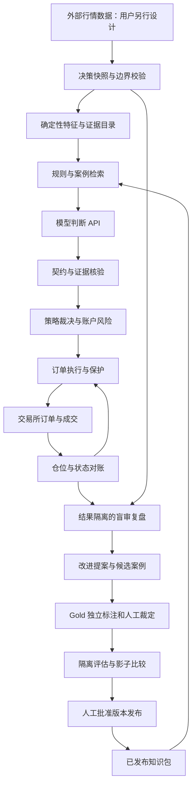
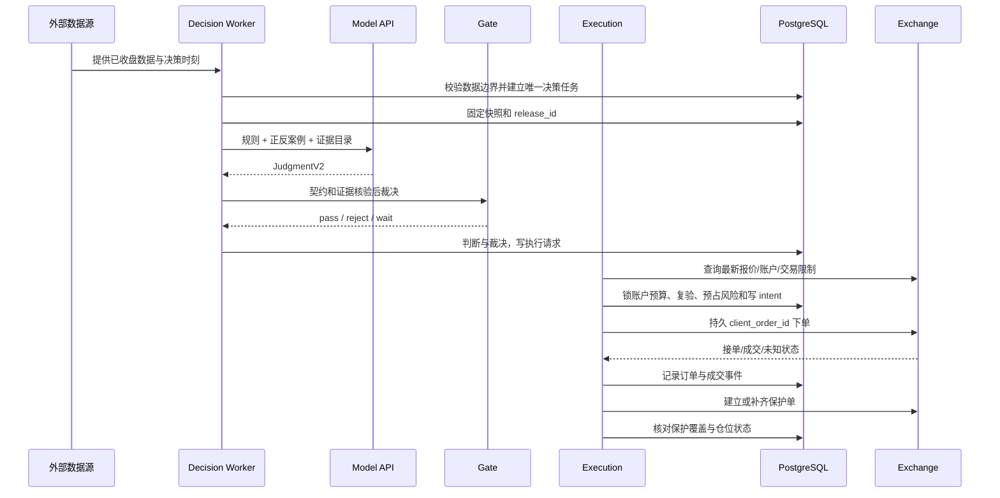
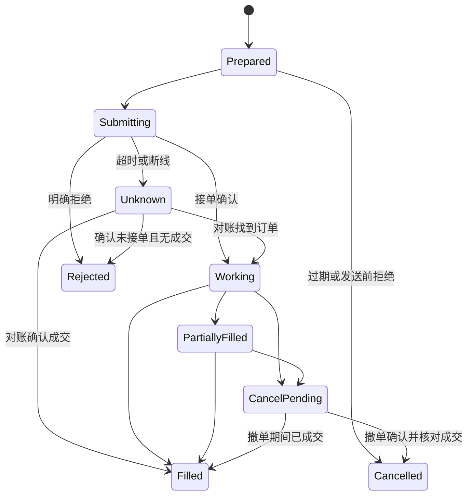

# 价格行为自动交易与学习系统架构 v1

日期：2026-10-30。状态：待实现的架构设计；本文不是现有功能清单。产品依据为 review-out/应用建设方案-20261030.md；Gold 标注规则见 review-out/gold复核-20261030.md。

## 1. 架构决策与范围

目标是把通用模型 API 作为判断器，形成“可信证据 → 自动交易 → 盲审复盘 → 验证改进 → 发布知识版本”的闭环。学习发生在规则、案例、提示、特征和评估系统中，不假设 API 自动训练权重。

v1 采用 Python 模块化单体，同一仓库与镜像，按职责运行不同进程。在线交易与离线学习隔离；二者只通过不可变快照、审定案例和已发布版本交换数据。离线复盘不能直接修改正在交易的规则。

设计默认：单交易所、单账户、多标的、单向持仓；同一标的不叠加多个策略仓位。订单适配器保留交易所差异，首版先实现一个。行情来源由用户另行设计，本系统只消费外部提供的数据，不规划采集、订阅、补历史或行情接入部署。现货或线性合约需用户确定；只在执行适配器和风险计量中启用对应能力，现货不得下裸空单，逆向合约不在 v1 范围。

| 决策 | v1 选型 | 理由与限制 |
|---|---|---|
| 领域代码 | Python；保留 perception/judge/gate/eval | 现有业务计算可复用，避免重写规则 |
| 控制 API | FastAPI + Pydantic，HTTP JSON | 负责查询和控制，不承担进程内的持久交易任务 |
| 持久化 | PostgreSQL，SQLAlchemy + Alembic | 原子风险预占、状态迁移、任务认领和审计统一落库 |
| 任务调度 | PostgreSQL jobs/outbox 表 | 初期不引入 Redis、Kafka 或分布式工作流平台 |
| 大对象 | 持久文件卷，以 SHA256 寻址的压缩 JSON | 保存模型输入输出、考题包、评估报告；DB 保存哈希与索引 |
| 案例检索 | PostgreSQL 结构字段过滤与确定性排序 | 先保证隔离与可解释；暂不引入向量库 |
| 监控界面 | 薄 Web 控制台，调用控制 API | 交易状态、证据、复核差异和版本比较；行情图组件另行选型 |
| 部署 | 单台 Linux 主机上的容器进程 + PostgreSQL + 持久卷 | 无高可用承诺；交易所原生保护单承担主机宕机时的基础保护 |

生产与开发数据库、文件目录、账户凭证分离。库内 mode 字段用于审计，不作为隔离真实资金的唯一手段。

## 2. 总体结构



在线每次判断读取固定 release_id；离线产物仅进入候选区。账户密钥只注入 execution 进程，模型判断器与学习进程无交易权限。上线模式只改变 execution adapter，不改变证据、契约、裁决和事件记录接口。

### 进程边界

| 进程 | 任务 | 故障影响 |
|---|---|---|
| api | 查询、标注裁定、暂停/恢复、提交发布请求 | 不影响已有交易所保护单；不直接下单 |
| decision-worker | 构建快照、检索、模型调用、证据校验、策略 gate | 超时只导致不新增订单，不阻塞订单/仓位管理 |
| execution | 账户同步、风险预占、下单、保护、退出、周期对账 | 原生保护继续；进程恢复必须先对账，未完成不得开仓 |
| learning-worker | Gold A/B 标注、盲审、差异、评估、改进提案 | 不影响在线交易；有独立 API 配额与并发限制 |

execution 首版单实例，由进程管理器防重启重叠；启动持有账户级数据库互斥锁，失去 DB 连接立即禁止新发送。旧实例是否结束不明时不得自动接管账户写权限，必须确认退出并对账。不能声称数据库锁能为交易所 HTTP 请求提供端到端 fencing。

## 3. 模块职责与现有代码映射

| 模块/拟增目录 | 输入 → 输出 | 复用与新增边界 |
|---|---|---|
| snapshots/ | symbol + as_of + release → Snapshot | 新增；多周期截止、不可变数据清单 |
| perception/ | 已可见 bars → FeaturePack/EvidenceCatalog | 保留 build_feature_pack；补多周期、确认时间、MM、当前回调与结构证据 ID |
| knowledge_service/ | Snapshot + release → ContextBundle | 替换固定取样方式；只检索审定、准入且不重叠的案例 |
| judge/ | ContextBundle → JudgmentV2 | 复用 build_prompt 思路；新增模型适配器、完整 schema 校验、事实引用核验 |
| gate/ | JudgmentV2 + pack + historical ledger → GateDecision | 复用 adjudicate/build_flags；补当前未覆盖的证据条件、订单方向与数值检查 |
| execution/ | GateDecision + 账户/行情 → OrderIntent/Fill/Position | 新增；唯一有权发交易请求的模块，最终复验与风险预占在此执行 |
| review/ | 盲审快照 + 冻结判断；之后解封执行结果 → Review | 替换 reflect.py 的结果驱动初分，支持多问题标签 |
| gold/ | event + A/B 标注 + 核验 + 裁定 → GoldRelease | 新增；与生产检索库隔离的候选池 |
| eval/ | 固定版本 + 隔离数据 → EvaluationReport | 复用回放/台账；新增未来隔离、事件消融、质量指标和发布对照 |
| releases/ | 规则/提示/案例/模型/特征清单 → ReleaseBundle | 新增；原子切换 active release，可回滚 |
| storage/、api/ | 领域请求 → 数据库事务/HTTP 响应 | 新增；业务规则不写进路由层 |

现有缺口必须显式修复。**2026-10-30 复核后已修**（均有回归测试锁住）：

| 已修缺口 | 修法 |
|---|---|
| CLI gate 固定第 180 根、未传台账、未传 context | 决策根可传参；台账与 context 均接线；传空台账时 H6 在 notes 里写明「无该格样本」，不再静默 |
| schema 的 `order_type` 与 gate 的 `limit_in` 两套键名 | 以 `order_type` 为准，`limit_in` 仅兼容旧调用 |
| 费用双轨：replay 硬编码 0.0005，`net_rr` 读 config（限价 0.02%） | 回放统一读 config，限价单入场按限价费率结算，与 H1 同口径 |
| 召回自样本泄漏与池退化 | 排除自身与同标的的重叠窗口，只从 dev 池召回，按 (语境, 结论) 轮转；原先任何样本恒返回 ex-APT + ex-ARB |
| 评估链路依赖 numpy | `summarize` 改纯标准库，gold_run/gold_build 在无第三方包环境可跑 |

**仍未修**，须在对应阶段处理：`void_if` 是文本（无受限表达式与解释器）；回放未执行前提失效（core 红线 5，只结算止损/目标/到期）；`second_bar_confirmed` 仍是模型自声明；S1 `parabolic` 无生产者（判据需新常数）；案例池（`knowledge/examples`）无 split 字段，未纳入 §8.1 的隔离模型。不能仅包一层 HTTP 就宣布交易链可用。

H6 按 setup×语境读台账，仓位建议按 setup 全池的已实现统计取值。台账只包含决策时刻以前已结算的记录，回测时按事件逐笔推进；不得把当前评估批次的未来交易提前累加。现行 H6 是“n≥3 且累计 wins=0”，不是通用的“最近三连败”。

## 4. 核心数据契约

所有领域对象使用 schema_version；价格与数量在执行契约中用十进制字符串，数据库使用 NUMERIC，禁止用展示四舍五入后的价格生成订单。历史 float 特征需在适配层验证精度，不能把 tiny-price 特征归零。

### 4.1 Snapshot 与时间边界

Snapshot：snapshot_id、symbol、venue、market_type、decision_close_time、created_at、release_id、各周期 bar_revision_id 列表、data_hash、features_hash、quality_state。

每根 K 线记录 open_time、close_time、received_at、is_closed 和 revision；每个结构同时记录 pivot_time 与 confirmed_at。有效信息须在决策截止前收盘，并在实际请求前已收到；历史回测缺 received_at 时记录可用性假设，不假装复原了真实延迟。

交易周期决定触发事件；大级别仅做背景。外部若以聚合方式提供大级别数据，必须声明底层 bars 完整且覆盖整周期；本系统校验其完整性，不在此设计聚合服务。尚未收盘或缺数据的大级别标未定，不回填未来收盘。交易所修订历史 K 线生成新 revision，已冻结快照仍引用旧 revision。

### 4.2 Evidence 与条件矩阵

Evidence：evidence_id、snapshot_id、kind、observed_facts、interpretation、timeframe、bar_refs、price_refs、feature_path、confirmed_at、dependency_group、verification_state。

Condition：rule_id、role(required/enhancing/veto)、status(met/not_met/unknown/not_applicable)、evidence_ids、counter_evidence_ids、reason。角色和适用性来自发布的 setup 规范，AI 不能把 required 改成 enhancing，也不能擅自将适用条件标成不适用。

FeaturePack 提供可核验的事实；模型可提出组合解释，验证器分别检查“引用存在”“事实为真”“推断符合规则”。仅验证引用存在不足以证明判断正确。尚不能自动确认、又未在人审生产协议中定版的必要结构，标 unknown，不进入实盘可执行集合。

三推检测输出每段锚点、回撤分隔与确认时间；测试检测输出测试区域、首次进入/离开、再次进入、失败/接受证据；MM 输出 measurement_start/end、projection_base、target 和选用时间。允许无结构，不强制检测器在每段行情找出三推。

### 4.3 JudgmentV2 与 TradePlan

JudgmentV2：decision_id、snapshot_id、release_id、hypotheses、primary_id、candidate_state、setup_version、conditions、strongest_countercase、missing_conditions、plan、expires_at、candidate_event_id。

candidate_state 取 observe/wait/ready/cancelled；ready 必须有 TradePlan，wait 必须有等待条件和过期条件。计划由 entry、stop、targets、invalidations、time_exit、risk_request 组成，side 与 order_type 为受控枚举。

失效条件采用受限表达式，而非执行模型生成代码。例如：

```json
{
  "kind": "close_crosses",
  "timeframe": "15m",
  "operator": "gt",
  "level_ref": "evidence:broken_resistance.upper",
  "consecutive_closed_bars": 1,
  "action": "close_position"
}
```

level_ref 在批准时解析并冻结成具体价位，之后不得跟着最新特征漂移。参数由当前 setup 版本限定，模型不能任意选择观察周期或确认根数。v1 只允许受支持的收盘比较、固定目标、硬止损和到期事件；不支持的条件拒绝为不可执行。到期 bar 数沿用当前规则版本，挂限价成交晚不顺延。

### 4.4 GateDecision 与订单授权

GateDecision：decision_id、verdict、hard_hits、soft_hits、risk_mult、rr_plan、rr_current、size_hint、policy_version、valid_until。gate pass 是策略层通过，不是直接交易权限。

ApprovedIntent：intent_id、decision_id、account_id、mode、symbol、side、quantity、entry_spec、stop_spec、target_spec、invalidations、reserved_risk、release_id、valid_until、client_order_id。

execution 只有在最新报价、账户和交易规则校验完成，并在同一数据库事务中预占风险、写入 intent 和待发送任务之后才获得发送资格。AI 不决定最终数量、杠杆或绕过风险预算。

## 5. 一次在线判断到交易的时序



1. decision-worker 对外部提供的数据完成边界与完整性校验，按唯一 (venue, symbol, timeframe, close_time, revision) 建立处理记录；具体传输方式留给用户的行情方案。同一 active release 每个决策时刻只建立一个在线 decision job；修订事件保留审计，不自动重做已成交决策。
2. decision-worker 固定 release 和 Snapshot；候选有待处理订单/已有仓位时先交执行状态约束，同标的不重复开仓。
3. 检索固定 context budget：常驻 core + 适用 setup + 主/大级别特征 + 最多 4 个审定正反案例 + 必需的近期 K 线。截断需留痕；缺失必需证据时不可 ready。案例排序以结构匹配和反例覆盖为主，不按盈利排名。
4. 模型响应进行 schema、有限数值、字段引用、时间与条件组合验证。一次结构化纠错机会仅用于格式问题，仍引用同一快照；不因结论空仓而重试到放行。每次响应留档。
5. 每个 decision job 有截止时间，迟到响应只能审计，不执行。截止时间来自策略有效期与运行参数，启用前显式配置；等待条件变化可触发新快照，新旧决策不能混用。
6. execution 对当前报价重算可执行性、净 RR、滑点预算与数量。若市场已偏离计划许可价格则拒绝，不沿用决策收盘价假装成交；历史回放应增加计算/下单延迟场景。
7. 行情更新、账户快照和 release 的适用性在发送前再次检查；失效 intent 取消并释放尚未成交风险。已成交部分转持仓风险，不能在部分撤单后全量释放。

运行模式：replay 只读截止之前行情并走历史撮合；shadow 只记录拟执行 intent；paper/testnet 使用模拟/测试适配器；live 使用真实适配器。shadow 结论不作为真实成交，测试环境撮合结果不宣称等同实盘。

## 6. 账户风险与订单、持仓状态机

### 6.1 风险边界

策略层检查方向、结构、首目标 RR、必要证据和 H1–H6；账户层检查数据健康、交易所能力、账户权益、总风险、现有仓位、资金/保证金、最小数量、价格步长、费用与滑点。

线性产品的建议数量按风险预算除以“每单位止损距离 + 费用 + 已配置滑点预算”估算，并向下对齐数量步长，再检查名义/保证金上限。数量小于最小下单量时拒绝，不能向上补足而超风险。费用口径按订单类型统一；合约另记录资金费与清算相关约束。预算是估计，不保证跳空损失不超出预算。

单笔风险不得超过现有 1% 上限；账户总风险、日亏损阈值、最大仓位数、行情陈旧阈值等为运行必填参数，live 缺任一项不能启动。size_hint 当前只是建议；执行器必须明确使用哪个 sizing_policy。v1 建议使用显式预算并受软规则降仓，凯利不自动接管；若启用证据型凯利，证据不足给 0 的语义必须保留，不能悄悄退回满风险。

### 6.2 订单状态



状态推进以交易所订单与成交事实为准，允许事件乱序后对账纠正；终态不能因旧回报回退。成交按交易所 trade_id 去重，部分成交累计量用于仓位，不靠订单状态猜测。

超时 Unknown 禁止直接换新 client_order_id 重下。查订单、成交和仓位后才能决定；若交易所不能可靠查询或识别重复请求，该适配器不能开启自动实盘。撤单确认前风险预占仍保留。图中 Rejected 的未知恢复分支只适用于有权威证据确认未受理，不能因一次查询未找到就判拒绝。

### 6.3 仓位与保护

Position：Flat → Opening → Protected → Closing → Flat；部分成交即进入待保护检查，不等待全部成交。ProtectionPending/ProtectionFault 为独立健康状态，可与 Opening/Closing 并存。

每次新增成交补齐对应数量的止损/目标保护。保护失败：取消未成交余单、暂停该标的新开仓、对已成交暴露按预定应急策略减仓/平仓；未确认平仓仍需重查与告警。只支持能满足保护协议的交易所能力，不假设下单和挂保护天然原子。

优先用原生 bracket/OCO/reduce-only；不同产品能力由 adapter 声明。两个退出请求不能导致反向仓位：每个 position 使用独立 close_intent 和减仓数量上限，撤掉剩余挂单并对账到 Flat。现货若无对应能力，必须实现并验证等价串行取消/卖出流程才能启用。

止损持续受交易所保护；前提失效由受限条件解释器监听指定周期收盘，不再问 AI 是否愿意退出。到期退出由调度器触发。生产固定目标到达即按计划处理，不等待额外反向证据。

恢复：启动暂停新开仓 → 查询持仓/挂单/成交 → 恢复 intent 与风险预占 → 检查保护数量 → 处理孤儿订单或未知仓位 → 对账一致后允许恢复。检测到人工改仓先冻结该标的并告警，不自动假定为策略的新交易。

## 7. Gold 工厂与学习架构

在线与离线共享 Snapshot/Evidence/规则解释器，但学习任务不读真实账户写凭证。Gold 详细标注语义沿用复核文档；此处定义工程流程。

### 7.1 Gold 工厂任务图


Case 状态：draft → packaged → annotated → verified → adjudicated → published；任一步可转 disputed 或 invalid，纠正时创建 case_revision。facts_verified、decision_adjudicated、outcome_reproduced 三项独立字段，不把“结果已算出”当决策已审定。

A/B jobs 只收到 blind_package_hash；结果文件不放在相同任务的资源清单中，模型工具也不提供数据集全目录读取。输出先各自持久化，再建立 diff job，禁止第二评审看第一评审答案。裁定前的人工界面也隐藏 outcome。

同一事件各快照只按时间递增评审，不提前暴露后续快照。event_group 同时标识重叠输入/结果区间，split_assignments 在调用模型前冻结；检索按事件、标的时间区间与使用权限过滤，不能只按 JSON 文件名排除自己。

数据选择分自然事件采样、随机对照和结果导向教学补充三类，存 sampling_policy；统计效果只用满足评估设计的集合。首批 20 个事件主要用于验证产线，10–15 个深入标注，不把此数量当作可靠收益估计。

### 7.2 复盘作业

TradeClosed 后生成 review job；同时抽取 wait/reject 决策复盘漏报。ReviewInput 分三个视图：

- blind：原时刻快照与当时规则，先独立判断，不含原决策或结果。
- decision_compare：独立判断冻结后，加入原决策与证据，定位差异。
- execution_compare：决策质量冻结后，加入订单、成交、出场和净结果。

Review 输出问题列表，含 evidence_id、错误分类、严重度、当时可知性与建议动作。无法归因保留 uncertain。正常止损不自动标“判断正确”；合规盈利不证明有优势；同一笔允许感知、判断、执行问题共存。

### 7.3 从复盘到新知识版本

Proposal：draft → testing → accepted/rejected → included_in_release。记录问题模式、受影响事件、修改对象、旧/新版本、预注册指标和回滚条件。

修改对象可为检测器、setup 规则、提示模板或案例准入；一次实验尽量只变一个对象。代码类修改走普通代码审查和回归，不允许模型输出直接写生产 Python。知识/提示类候选只写 staging 区。

EvaluationRun 固定 baseline_release、candidate_release、split_manifest、execution_model 和 metrics_spec。先比事实错误、违规放行、漏报/误报与延迟，再分别报告净 R、回撤、成本和周期分布。测试门槛需事先登记；没有独立样本/统计证据时只能升为研究或 shadow，不能凭回测收益自动晋升 live。

发布由人工动作触发，写不可变 ReleaseBundle：core/setup hashes、feature_version、prompt_version、retrieval_policy、允许案例列表、model/provider 配置、gate/exit/sizing 版本、验证报告哈希。active_release 在 DB 单事务切换。已有持仓仍按入场 exit_version 管理；旧版本尚未发送的开仓 intent 在切换时取消，未来判断使用新版。

回滚只影响新决策与未发送 intent，不回写历史、不改变已有持仓止损目标；账户紧急风控可独立收紧。候选案例多不等于学得好，只有隔离验证支持的版本变化算改进证据。

## 8. 存储模型与一致性

### 8.1 核心表

| 表 | 关键字段与约束 | 主要写入者 |
|---|---|---|
| bars | 外部数据的本地审计副本；venue/symbol/timeframe/open_time/revision 唯一；OHLCV、close_time、received_at | decision-worker / 离线数据导入 |
| snapshots | id、as_of、release_id、manifest_hash、quality；不可变 | decision/gold |
| model_runs | id、purpose、snapshot_id、request/response_hash、provider_model、usage、status | workers |
| decisions | id、snapshot_id、release_id、judgment_hash、gate_hash、state；在线决策键唯一 | decision-worker |
| risk_reservations | intent_id 唯一、account、reserved/filled/released_amount、version | execution |
| order_intents | id、decision_id、account、mode、plan_hash、client_order_id 唯一、state | execution |
| orders / fills | venue_order_id 唯一范围含账户；fill 唯一键 account+venue_trade_id | execution |
| positions | account+symbol 单活跃仓；qty、entry、exit_policy_hash、protection_state、version | execution |
| domain_events | aggregate_id、sequence 唯一、event_type、payload、occurred/received_at | 各领域事务 |
| jobs / outbox | dedup_key 唯一、type、payload_ref、lease_token、lease_until、attempts、status | 调度/各领域 |
| cases / annotations | event_group、snapshot_id、case_revision、split；annotation role+run_id | learning-worker |
| reviews / proposals | decision/case refs、blind_verdict_hash、issue list、status | learning-worker/人工 |
| releases / evaluations | manifest_hash 唯一、stage、报告 refs；active pointer 独立记录 | 发布事务 |
| account_controls | account、pause_entries、reason、risk_policy、active_release、version | 控制 API/execution |

v1 EvidenceCatalog 和完整条件矩阵存快照/判断 JSON 对象，DB 只索引常用 kind/setup/status；无需把每个理由拆成独立关系表。教案检索字段从已发布案例提取，结果字段不进入默认模型上下文。

### 8.2 事务规则

- 领域状态变化、domain_event 与 outbox 同一事务提交；任务扫描 outbox 建 job，重复投递靠 dedup_key 消除。
- Worker 使用短事务认领任务并设置 lease_token/lease_until，提交后才调用外部 API。成功写回须校验 token，过期 worker 不能覆盖新持有者结果。租约重领可导致模型重复计费，但只允许一个有效领域结果。
- 数据库队列采用 FOR UPDATE SKIP LOCKED 领取可运行 job。它用于减少队列争用，不代表快照查询或交易发送具有“恰好一次”语义。
- 外部下单无法与 DB 原子提交，靠持久 intent、交易所 client_order_id 和对账恢复处理。订单任务不能直接使用普通 jobs 的“失败自动重跑”逻辑。
- account_controls/预算记录按账户串行锁定，预占与 intent 同事务；状态更新使用 version 比较，防两个标的同时看到同一剩余额度。
- 内容对象先写临时文件、校验 hash、原子 rename，再提交 DB 引用；未被引用的对象可延迟清理。对象不存在或 hash 不符时不得执行依赖任务。

### 8.3 环境与留存

回测和 Gold 工厂可使用独立 research 数据库。生产只读同步已发布的知识对象与案例，research 账户不能更新 production active_release。时间统一存 UTC，界面按用户时区显示。凭证从部署 secret 注入，不写入模型请求、日志或版本清单；外部标注文本作为数据处理，不能覆盖系统规则。

DB 与对象卷都需备份，恢复演练须验证快照哈希、订单状态与实际交易所仓位。不能只恢复数据库而丢失判断输入，或在未对账状态恢复新开仓。

## 9. 内部接口与控制 API

### 内部模块契约

```text
SnapshotService.freeze(symbol, as_of, release_id) -> SnapshotRef
PerceptionService.build(snapshot_ref) -> EvidenceCatalogRef
ContextService.build(snapshot_ref, release_id, purpose) -> ContextBundleRef
ModelAdapter.judge(context_ref, response_schema, deadline) -> ModelRunRef
EvidenceVerifier.check(judgment_ref, snapshot_ref, setup_version) -> Verification
StrategyGate.evaluate(judgment_ref, verification, historical_ledger) -> GateDecision
ExecutionService.prepare_and_send(gate_ref) -> IntentRef
ExchangeAdapter.submit/query/cancel(intent_or_order_ref) -> ExchangeResult
ExchangeAdapter.fetch_positions/fills/open_orders() -> ExchangeFacts
ReviewService.enqueue(decision_id, review_policy) -> JobRef
GoldService.build_batch(sampling_manifest, release_id) -> BatchRef
EvaluationService.compare(baseline, candidate, dataset_manifest, metrics_spec) -> RunRef
ReleaseService.activate(release_id, expected_active_id, operator) -> ReleaseEvent
```

方法签名是拟实现的逻辑接口，不能直接当现有可调用函数。外部行情如何传入、是否推送或共享存储由用户后续方案确定；本文仅定义可见数据和决策时刻的输入边界。ExchangeAdapter 仍承担订单、账户与执行前报价核验。

### 控制台 API

| 接口 | 行为 |
|---|---|
| GET /v1/health、/v1/accounts/{id}/status | 数据/任务/执行健康，仓位与保护状态 |
| GET /v1/decisions/{id} | 快照、证据、判断、gate、执行链引用 |
| GET /v1/positions、/v1/orders | 持仓、订单及对账异常 |
| POST /v1/accounts/{id}/pause-entries | 立即禁止新开仓，不撤销保护；参数含 reason |
| POST /v1/accounts/{id}/resume | 校验健康、配置、对账和批准的 release 后恢复 |
| POST /v1/positions/{id}/close | 创建幂等减仓 intent，不直接从 HTTP 路由调用交易所 |
| POST /v1/gold/batches | 输入 sampling_manifest，返回异步 job_id |
| GET /v1/gold/cases/{id}/review | 按评审阶段返回 blind/diff；冻结前隐藏 outcome |
| POST /v1/gold/cases/{id}/adjudications | 提交有证据的裁定，带 expected_revision |
| POST /v1/evaluations | 建立固定版本对比任务 |
| POST /v1/releases/{id}/activate | 验证报告和部署模式，原子切换；带 expected_active_id |

写接口要求认证、角色检查、Idempotency-Key 与操作审计；普通查看者不能启用 live 或修改风险配置。重复请求返回同一操作结果，状态冲突返回 409；长任务返回 202 + job_id，页面轮询状态。v1 不需要公开直接下单接口，也不把“AI 同意”当用户身份认证。

## 10. 三推多因素案例如何穿过架构

以下为研究流程示例，标的周期仅用于解释，不是启用的交易配置：交易周期 15m、背景 4h。

1. 15m 收盘，Snapshot 固定截至该时刻最近已收盘的 4h 数据；未收盘 4h 不输入背景特征。
2. EvidenceCatalog 提供 e_resistance、e_mm、e_pushes；三推是否衰竭由具体推进/回撤事实支持，不能只有“三推=true”。
3. 第二测试尚未失败时，模型返回 wait，required:test_failed=not_met，列出反证与取消条件；不生成订单。
4. 后续收盘触发新 Snapshot；模型引用新失败/跟进证据，setup 必需项都满足才可 ready。若无法满足现行 C1/B3，而只符合研究组合，release.stage=research 使执行器禁止 live。
5. gate 验证证据和目标；execution 再检查当前可成交价格。确认过晚导致净 RR 不足时写拒绝结果，而不是改目标或缩止损。
6. 合格且在允许模式下执行，原生保护和结构化失效条件开始生效；模型宕机不影响硬止损。
7. 结束后盲审先检查 e_resistance/e_mm/e_pushes/e_test/e_trigger，最后才揭示亏盈；若出现重复的“把第二次到达误判为第二次失败”，生成针对该错误的提案和正反案例，不自动添加“以后禁止三推交易”。

## 11. 故障策略与可观察性

| 场景 | 必须行为 | 验收证据 |
|---|---|---|
| 重复收盘事件/任务重领 | 一个有效决策、一个开仓 intent | 唯一键与事件日志 |
| 模型超时/畸形 JSON/晚到回复 | 记录失败或过期，不新增订单 | model_run 状态与零 intent |
| 大级别缺 bar/旧行情 | 不得 ready；已有仓位按配置的数据故障策略处理 | quality_state 与执行暂停记录 |
| 下单超时但交易所已成交 | 查询恢复原订单，禁止换 ID 重下 | 唯一成交与仓位一致 |
| 部分成交后保护失败 | 取消余单并执行暴露恢复策略 | 保护/减仓事件与最终仓位 |
| DB 不可用 | 不新增下单；原生保护保留，执行器告警并等待恢复对账 | 无新风险、恢复演练 |
| 主机宕机 | 原生保护仍在；前提失效/到期无法保证准时执行，恢复后补处理 | 记录实际延迟与偏差，不冒充正常退出 |
| 模型/知识版本切换 | 新判断用新版，持仓沿用原退出版本 | release 与 position 引用 |
| 复盘发现盈利违纪 | 纪律问题计错，结果独立保留 | review 标签与 outcome 分离 |

监控至少包括：行情延迟/缺口、模型延迟/错误/费用、任务积压、过期决策、证据核验失败、gate 拒绝原因、Unknown 订单、未保护数量与持续时间、对账差异、风险预占、知识版本分布。记录 trade/decision/job/release 的关联 ID，禁止仅写不可检索的自然语言日志。

未知订单、未保护仓位与对账差异需要立即告警；模型预算耗尽只暂停新分析，不能耗尽执行器资源。各告警阈值与故障处置参数纳入运行配置，启用 live 前必须通过演练。

## 12. 实施顺序与交付门槛

| 阶段 | 具体交付 | 必须验证 |
|---|---|---|
| A：契约与证据基础 | contracts v2、Snapshot、EvidenceCatalog、数据修订与多周期截止；修现有 RR/腿数/CLV 问题 | 未来不可见、确认时间正确、小价格精度、引用真实、现有 gold 结果变化可解释 |
| B：Gold 工厂 | case/jobs/annotations 表、A/B API 适配、diff、人工裁定、20 事件试点 | 无自样本泄漏、独立评审、同事件不跨 split、先冻结后揭示 |
| C：可验证判断 | 发布包、检索过滤、结构化判断、完整条件 gate、台账截止视图 | 等待/反证/未定/非法计划不下单；先以冻结响应回归，再跑真实 API 评估 |
| D：执行与恢复 | replay/paper adapter、订单/仓位状态机、风险预占、保护、对账 | 并发风险、重复事件、超时已成交、部分成交、撤单竞态、重启恢复与保护失败 |
| E：闭环评估 | 盲审三视图、改进提案、消融、基线对照、发布/回滚 | 正确亏损不自动改规、盈利违纪不获奖励、过拟合版本不晋升 |
| F：实时与有限实盘 | 选定交易所适配器、运行参数、影子/测试验证、监控 | 产品能力核实、故障演练、风险配置完整、用户明确启用后才可 live |

A/B 优先解决“怎样得到可信知识”，C 验证 API 能否执行知识；D–F 才承担自动交易的真实状态与资金边界。每阶段产物可运行验收，不以文档完成代替代码完成。前端先做证据差异审定和运行状态页面，不阻塞核心链的测试。

## 13. 待确定输入与架构影响

| 输入 | 当前设计如何推进 | 何时必须确定 |
|---|---|---|
| 交易所与现货/合约 | 先做 paper adapter 和能力契约，不预设真实端点 | F 前，决定保护单、减仓语义、合约计量 |
| 标的、决策/背景周期 | 用现有历史样本构建多周期契约；缺失数据显式标记 | A/B 外部数据准备前确定试点组合 |
| 模型 API 与预算 | provider-neutral ModelAdapter，记录请求与响应能力；不依赖某厂商私有记忆 | B 首次调用前配置凭证/模型/成本限制 |
| 规则阈值与新组合 | 保留现行已定版规则，新组合只在 research | C 可执行判断及新规则发布前 |
| 风险与运行参数 | 配置结构与校验先实现，缺值拒绝 live | F 前明确资金与最大损失范围 |

## 14. 技术依据

数据库任务认领可使用 PostgreSQL 的行锁与 SKIP LOCKED；官方文档说明其可用于队列式消费者，且跳锁视图不适合一般一致性查询，见 [PostgreSQL SELECT](https://www.postgresql.org/docs/current/sql-select.html)。本设计据此只将它用于任务认领，账户风险另用事务锁和约束。

进程部署需要单独考虑启动、重启、进程复制与资源占用，见 [FastAPI Deployment Concepts](https://fastapi.tiangolo.com/deployment/concepts/)。本设计将持久任务与 HTTP 进程分开是项目选择，不是框架自带的订单可靠性保证。
