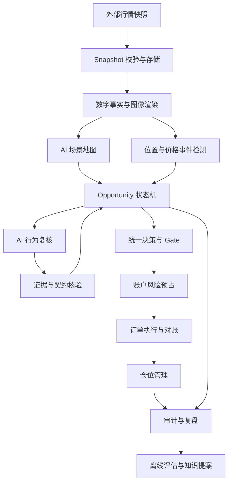

# 自动交易优化设计 v2.2：从单点判读到持续机会管理

日期：2026-10-31。v2.2 修订。已核验本地基线：main / 50559aa。上传的 v2.1 引用了 d9e80db、489b807；这些较新提交、forward_waits 实现及其测试数量尚未在本次本地核验。状态：待实现、待验证的工程设计，不代表已有交易收益证据。

**继承的 v2.1 修订摘要**（依据对 pa-system 代码与 eval/reports 实验裁决的核对；条款编号不变，改动处以【v2.1】标注）：

1. §2.1 新增：补入代码核对结果，尤其是触及口径 A/B 实验的结论；明确本设计不以放宽位置执法或提高出手率为目标。
2. §6.1 新增：现有 eval/forward_waits.py 已实现等待对象的一部分，P1 以它为起点扩展，而不是重新发明；补 due→重判闭环与多次测试接续。
3. P0 增加：修复回放对 market 型 stop 计划无条件成交的缺陷，并把受影响的历史统计重新分类。
4. v2.1 曾将 Gold 设为 P3 前置；v2.2 改为与执行沙盒并行、在 P4 汇合。停机开关保留在 P3。
5. 消除 §6 与 §15、§8 与 §14 的不一致，补充行为复核限流、unknown 的可度量与可终止规则、接入参数。

【v2.2 首版范围约束】：首版 limit 单只在 required 全部 met 后生成，不支持"行为未成立先预挂单"；READY 之前没有人工审批环节，人工只经停机开关和人工处理队列介入；unknown 连续复核次数上限由接入参数给出，不设默认数字。

本文补充《自动交易与学习系统架构-v1.md》，优先定义现有原型如何迁移。与 v1 冲突时，以本文的候选生命周期和订单语义为准。技术选型沿用 Python 模块化单体、PostgreSQL 持久状态与任务队列；不新建微服务、消息中间件或模型训练平台。

## 1. 目标、边界与成功定义

目标是让通用多模态模型 API 能持续理解一个交易机会：在什么位置，等待什么行为，何时触发，何时取消；程序负责精确计算、纪律检查、订单执行和事实记录。

本次不设计行情采集，不更换既有策略卡，不以减少 no_trade 或提高交易次数作为单独的成功标准，不自动调整真实账户风险参数。外部提供带时间边界的行情快照。首版单交易所、单账户、同一标的不并行叠加策略仓位；交易所、产品类型、账户风险预算和模型供应商在接入时配置并验证，本文不假定现货支持裸空或任意产品支持原生保护单。

成功必须同时满足：

1. 同一位置的后续测试能更新同一个机会，等待条件不丢失、不无声改变。
2. 触及、行为成立、入场触发、订单成交各自有独立记录和时间。
3. 不发生未触发却成交、事后补认挂单、重复下单或超预算下单。
4. no_trade 可以定位到具体阶段及规则；正确放弃与漏掉机会分开计量。
5. 在冻结评估集上减少人工裁定的漏判，且纪律违例不增加；收益单独报告，不用单笔盈亏判定决策质量。

## 2. 基线问题与处置

| 当前证据 | 工程问题 | 本设计处置 |
|---|---|---|
| build_events 按 high/low 触及检测，forward_shadow.record 按 close 在带内执法 | 拒绝反应可能被误归类为位置不对 | 分离测试位置、行为证据与当前可执行价格 |
| no_trade 保存 pendings 后结束本次判读 | 【v2.1】已有 forward_waits 登记并机械核对，但 due 之后没有重判派发，且 due 为终态，无法接续二测 | 以 forward_waits 为起点扩展为持久化 Opportunity 状态机（§2.1、§6.1） |
| prompt_builder 将 stop 触发写成 market，replay 非 limit 路径直接模拟已成交 | 触发与成交语义不一致 | 三类订单统一契约、独立成交模型 |
| route_cards 先根据机器趋势选卡 | 图读开始前已缩窄策略菜单 | 先给完整精简目录，再按图读假设加载详细卡 |
| 各 runner 分别组装 plan、context 和地图执法 | 实验与在线行为漂移 | 公用 DecisionService，runner 只提供数据和实验参数 |
| compute_trigger 在事件后向前寻找地图根 | 不能等同于真实提前规划 | 回溯地图标记研究用途；在线地图记录真实生成时刻 |

已有 forward-output-anatomy 报告曾记录 76 份判读仅 2 个候选、gate 拒绝 0 个；补记中 81 个地图事件有 55 个盘中触及但收盘离带。这支持优先排查候选之前的损失，不证明每一个离带事件都应交易。最新规则的效果仍需重新评估。

### 2.1 【v2.1】代码核对补充

以下继承 v2.1 的核对记录。其中 touch-ab 已与本地报告核对；489b807、182 项测试和 waits 代码描述待获取对应版本后核验，不作为已通过验收。

- **回放缺陷属实且影响面最大。** judge/prompt_builder 要求顺势计划写成"stop 触发、order_type=market"，而 eval/replay 对非 limit 计划直接从决策后第一根起按 entry 价模拟成交，不检查价格是否到过 entry。A1/A2/B2 等相关历史计划全部进入影响审计，分别标记未触发误成交、成交价偏差、语义不明或结果未受影响；不能假定每笔结果都错，也不能在审计前与新语义结果直接比较。
- **触及口径已被实验检验。** touch-ab（预注册）把到达认定放宽到触及后，55 个脱带事件只多出 2 个候选（3.6%），均为 B3 限价多头；唯一解析的一笔 −0.3607R，入场当根前提即破。报告建议暂不采进执法；仅一笔终局不足以证明触及口径普遍无效。53/55 仍无候选，说明改变到达认定不足以解决候选稀少，冻结分支条件需要进一步逐例核查。因此本设计的目标是让等待可审计、可接续，不是放宽位置执法或提高出手率。
- **出手率解剖。** 76 份判读 2 个候选、gate 拒绝 0 个；71 份有地图的 no_trade 中仅 20 份（28%）决策收盘在点位带内；在带仍不出手的 582 条缺项中，位置类 204、触发未齐 156、其它 157。
- **waits 注册表已落地。** 冻结条件集、观察带、两段式 recheck（先整根离开、再回到）、cancelled/expired 已实现，见 §6.1。
- **"前向影子"实为近期历史回放。** 它在尾部 45 根内寻找已发生的事件，再由 compute_trigger 回溯画图，不满足 §10 对真实前向的要求；compute_trigger 在 eval/event_ab.py 与 eval/forward_shadow.py 各有一份实现。
- **没有人工裁定对照。** 现有 A/B 实验的判读者都是模型，缺 Gold 集，见 §11。

## 3. 目标运行架构



首版运行三个进程：API/控制台、decision-worker、execution-worker。离线评估用独立命令和数据库。decision-worker 处理地图与机会，execution-worker 处理订单和保护，不依赖 AI 请求及时返回。PostgreSQL jobs/outbox 承担任务认领和可靠投递，租约过期后允许重试，业务操作必须幂等。

### 3.1 模块归属

| 模块 | 建议落点 | 输入 → 输出 |
|---|---|---|
| 快照与证据 | 新增 runtime/snapshots.py；复用 perception | 外部数据 → 不可变 Snapshot、Fact、图像哈希 |
| 地图规划 | judge/campaign_prompt.py + 新增 judge/model_client.py | 同边界图像与数字 → SceneMap |
| 事件计算 | 新增 runtime/events.py，提取现有检测公共函数 | 新价格事实、活跃位置 → MarketEvent |
| 机会管理 | 新增 runtime/opportunities.py（由 eval/forward_waits.py 迁移而来） | 事件、AI 核验 → 状态迁移及任务 |
| 决策入口 | 新增 judge/service.py | 候选、证据、版本 → DecisionResult |
| 风控 | 保留 gate；新增账户预算管理 | 计划与账户状态 → 拒绝或风险预占 |
| 执行 | 新增 execution/adapter.py、orders.py、reconcile.py | OrderIntent → 订单、成交、仓位事实 |
| 评估 | 保留 eval；复用统一决策入口 | 冻结输入与版本 → 漏斗、纪律、成交及收益指标 |

路径是迁移建议，不要求一次性建立空模块。先实现可测试的状态迁移及公共服务，再接持久化和模型 API。

## 4. 图像与数字的权责

AI 负责背景、形态、关键位置和行为解释；程序负责时间、价格、顺序、距离、费用、预算与成交核验。机器趋势、摆动和 MM 候选只是建议，不可直接否决图读或决定唯一策略菜单。

AI 提出的三推、二次测试、失败突破必须引用证据：bar_id 或时间区间、具体价格、观察描述、所属周期。程序验证 K 线存在、没有越过决策时刻、价格与 OHLC 相符；这种验证只确认事实引用，不声称证明形态解释正确。

模型提出的结构极值可以引用原始 K 线，不强制要求恰好属于机器 swing 列表。止损检查据此验证价格及越界方向，避免把机器识别能力变成图像识别的上限。

多周期数据由外部提供，统一以 decision_at 为截断点，高周期只使用当时已经收盘的数据；未完成高周期 K 线须单独标记，首版不用于成立条件。无高周期输入就不能声称存在大级别共振。

多因素证据按来源分组：背景、位置、结构、触发、空间、反证。三推、阻力、MM、二次测试可共同支持机会，但同一高点的不同名称不能重复计分。必须项、加分项、否决项沿用知识卡，不要求每笔交易同时集齐所有示例因素。

## 5. 数据契约

公共字段：schema_version、strategy_version、snapshot_id、created_at、decision_at。价格用十进制定点表示，时间统一 UTC；bar_id 使用标的、周期与开盘时间，不能用滚动窗口下标作长期身份。

| 对象 | 关键字段 |
|---|---|
| Snapshot | symbol、timeframes、cutoff_at、bars_hash、chart_hash、received_at |
| SceneMap | map_id、version、generated_at、source_cutoff、points、hypotheses、invalidations |
| Point | point_id、lo、hi、timeframe、anchors、evidence_ids |
| Opportunity | opportunity_id、map_version、point_id、setup、side、state、revision、conditions、cancel_conditions |
| Condition | id、role(required/bonus/veto)、basis(card/branch/skeleton)、evaluator、operator、args、evidence_ids、status |
| MarketEvent | event_id、symbol、event_time、observed_at、point_id、type、snapshot_id |
| DecisionResult | status、candidate、missing、counterevidence、rule_hits、reason_code、versions |
| OrderIntent | intent_id、opportunity_id、side、type、trigger_price、limit_price、quantity、stop、targets、expires_at |

条件 evaluator 只有 deterministic 或 model。确定性操作符首版限定 touch_zone、close_above、close_below、cross_level；复杂二次测试由 model 解释并引用序列，不开发任意表达式语言。模型输出 extra 条件仅记录复核，不能自动升级为必须项。

point_id 在地图内稳定，不随浮动均幅重新量化。地图更新生成新版本，明确替代哪些点和机会，不能静默修改旧条件。event_id 由来源、时间、点位和事件类型生成；模型请求键由 opportunity_id、revision、snapshot_id、任务类型构成。

## 6. 候选状态机

```text
WATCHING → TESTING → WAITING_BEHAVIOR → READY → ORDER_PENDING → IN_POSITION → CLOSED
     任一未成交状态 → CANCELLED / INVALIDATED
     校验或服务故障 → 暂停任务，保留业务状态并记录故障
```

| 转移 | 条件 | 动作 |
|---|---|---|
| WATCHING → TESTING | 价格进入或触及观察位置 | 保存首次测试证据，唤醒行为复核 |
| TESTING → WAITING_BEHAVIOR | 必须行为尚未出现且无否决 | 保存具体缺项、取消条件，不重置已有证据 |
| TESTING/WAITING_BEHAVIOR → READY | 必须项成立、无否决、当前可执行计划通过 gate | 生成唯一 OrderIntent |
| READY → ORDER_PENDING | 风险预占成功、提交任务持久化 | 执行器发送订单 |
| ORDER_PENDING → IN_POSITION | 收到成交或部分成交事实 | 按实际成交量建立保护和仓位 |
| 未成交 → INVALIDATED | 价格反证、地图失效或条件被否决 | 停止入场，已有委托发起撤单 |

READY 时必须重新核算价格、首目标空间、止损距离、费用与风险；历史上发生过理想触发不等于现在还可交易。已有成交不能因机会取消而从账中删除；撤单竞态中出现成交，必须转入仓位管理。

价格行为取消和运营过期分开：前者表示假设失效；后者用于订单有效期、地图陈旧或数据失效，不将“等了几根”伪装成行为反证。

每次只把新增事实与原条件交给模型。二次测试须记录前一次测试及中间离开结构；

### 6.1 【v2.1】与现有 waits 注册表的衔接

本节与 §15 一并构成状态机口径；§6 的状态图与 §15 冲突时以 §15 为准（增加 SUBMITTING，READY 可回退 WAITING_BEHAVIOR 或 INVALIDATED）。

**保留并核验** v2.1 描述的冻结条件与观察带机制；scan 阶段不得新增、放宽或收紧条件。两段式 recheck 仅适用于明确要求再次测试的条件，不是全部等待的公共门槛。具体模式与计数按 §22。获取新版代码后先核验，再迁移，不据文件名假定功能齐全。

**必须补齐：**

- due 之后生成重判任务（请求键见 §5），重判沿用冻结地图与冻结条件集；现状只产 due 清单，无人消费。
- due 不是终态。重判后仍缺必须项则回到 WAITING_BEHAVIOR，同一 opportunity_id 继续等，assessment_count 加一；test_sequence 仅在新的测试边界成立时递增，并记录测试及中间离开结构；成立则 READY，出现反证则 INVALIDATED。
- 机会主键保持 opportunity_id；复核任务唯一键使用 opportunity_id、revision、snapshot_id 和任务类型，避免同一机会重判后因键已存在而无法再次登记。
- 现行取消口径（收盘越带 1×段均幅、连续 2 根）是代理指标，仅对明确采用该政策的迁移机会保留并标 proxy（附政策版本，不扩展到其他 setup）；知识卡有结构化取消条件的 setup 逐步替换，替换须单独对照。
- 存储分两步：先定义 repository 接口；文件实现仅供单写者研究/影子使用，必须限定进程独占，原子替换不能等同于跨文件事务或并发安全。PostgreSQL 实现承接多 worker、状态/outbox 原子提交与风险预占。切换存储不得与状态机语义变更放在同一次提交。

## 7. 事件器与模型调度

事件器分为两类：发现潜在位置的扫描、监控已建立机会的位置事件。后者优先按 AI 地图中的位置运行，不要求机器先识别同一种形态。

在线首次启动对当前快照画地图；之后在结构失效、关键位置发生事件或地图过期时更新。冷启动仅建立观察计划，不追认过去的触发或挂单。周期性低频地图复核可发现机器事件器漏掉的新位置，频率通过延迟和成本测量确定。

模型 API 通过统一适配器传入同一截止时刻的图像、数字和冻结条件，记录模型版本、请求参数、请求响应哈希、token 和延迟。响应必须通过契约及证据核验。超时、格式错误、拒答分别记为系统结果，不记为策略 no_trade；有限重试，旧 revision 的迟到响应不得覆盖新状态。

首轮只给完整精简策略目录；图读选出可能的 setup 后再加载详细卡。【v2.1】现有 knowledge/setups 共 7 张卡（每张约 2–3.5KB，G1 约 6KB），精简目录可直接实现，不依赖先做测量。控制上下文长度，保留价格序列和必要证据，案例召回的收益单独消融验证。模型不持有交易密钥，也不直接提交订单。

【v2.1】行为复核限流：事件仍按 §14.3 每根产生，限流只发生在任务创建层——仅当机会处于 TESTING/WAITING_BEHAVIOR 且该 bar 带来新增事实时才创建 assess_behavior 任务；单机会调用预算和并发上限为必填运行参数（§19）。被限流的事件必须落账，不得用"每点一次"截断事件本身。

## 8. 位置、触发和成交统一语义

位置被测试使用 high/low 或有序行情事实；行为是否成立按策略指定序列判断；入场可执行性使用提交时可获得的价格与剩余空间。P0–P2 保留现行候选资格检查：决策收盘位于地图点位带 ±0.25×段均幅内。盘中触及仅触发观察和行为复核，不自动获得提交资格。将位置资格改为策略专属条件属于后续独立实验，不在本轮迁移中实施。

【v2.1】前提：分离位置、行为与可执行价格，目的是让证据可审计、让等待可接续，不是放宽位置执法。touch-ab 的该批样本新增候选较少，唯一已解析交易出现逆向选择现象，证据不足以推断普遍效果（§2.1），故现行 ±0.25×段均幅的位置容差保持不变；任何放宽须单独预注册实验，不得夹带在 P0–P2 的迁移中。

| 订单 | 生成时必须成立 | 成交要求 |
|---|---|---|
| market | 行为已经成立，当前价格仍满足纪律 | 使用真实回报；回放使用决策后首个可执行价格加成本 |
| limit | required 已全部 met、无否决、通过现行位置资格和定价检查 | 仅从实际提交之后检测成交；触及不保证排队成交 |
| stop-market | 有效触发价、方向和保护计划 | 提交之后触发，再按可执行价格成交；跳空不能默认按触发价成交 |

【v2.1】首版 limit 单只在 required 全部 met、READY 生成之后创建（回踩单或翻面单）。"行为尚未成立先预挂限价单"不在首版范围；如策略卡需要，须单列设计并说明它与 §15 READY 条件的关系。

历史 OHLC 无法证明同根触发、止损和目标的先后。回放使用保守顺序并标记 ambiguous；有更细粒度数据时重放，分别报告敏感性。不得利用决策根内已经发生的触及，为收盘后生成的订单补成交。

多目标分批退出复用现有规则，但按真实成交数量、剩余仓位和费用结算。退出依据同样记录证据；首版不让 AI 自由移动止损或临时扩张风险，止损更新只能使用已发布策略允许的动作。

## 9. 执行、风险和恢复

gate 保留策略纪律；账户风控另行检查可用余额、单笔预算、总风险、同标的占用、当日损失限制、数据与报价新鲜度。模型提供的是计划，不是最终订单数量；执行器按产品单位、最小数量、步长和实际止损距离计算，并在提交前复核。

在同一数据库事务内执行机会版本比较、账户风险预占、订单意图和 outbox 写入。并发机会不能同时消费同一预算。client_order_id 稳定对应 intent_id；提交超时后先查询订单状态，不以新 ID 重复提交。

部分成交即按成交量保护；撤单必须等待确认，订单终结且无待确认成交后才能释放对应预占。保护下单失败时暂停新增风险，并执行适配器验证过的应急撤单/平仓流程和告警。无法可靠提供保护与对账的交易产品不得进入实盘阶段。

启动恢复先对账订单、成交、仓位与风险预占，再恢复新入场。连接异常时禁止新增风险，已有保护由交易所承接；恢复后处理撤单与成交竞态。账户密钥仅 execution-worker 可读。

## 10. 持久化与审计

核心表：snapshots、scene_maps、opportunities、opportunity_transitions、model_runs、decisions、order_intents、orders、fills、positions、risk_reservations、jobs、outbox。快照及图像使用哈希寻址文件存储，数据库保存引用。

opportunities 使用 revision 乐观锁；fills 对交易所成交 ID 唯一；orders 对账户与 client_order_id 唯一。每次状态迁移与产生的任务原子写入。审计保存原始模型输出和修订原因，不能只保留最后一份 JSON。

研究回溯地图、近期历史回放、真实前向影子分别标记 execution_mode，不混报样本外结果。【v2.1】现有 eval/forward 的运行方式（尾部 45 根找已发生事件、compute_trigger 回溯画图）迁移时标为 recent_replay 与 retro_map，不得并入真实前向统计；两份 compute_trigger 实现须合并为一份，并随结果记录其版本。真实前向必须满足地图生成和订单意图生成发生在对应后续价格事件之前。

## 11. 评估、Gold 与学习闭环

评估漏斗分别记录：发现位置 → 测试位置 → 行为成立 → 候选 → gate → 风险预占 → 提交 → 成交 → 退出。每层保存分母、拒绝原因、版本、延迟；正确 no_trade、缺数据、模型失败、订单失败分别统计。

Gold 从完整机会轨迹取样，覆盖正确等待、正确取消、合规亏损、违规盈利、漏判、合理入场和成交失败。标注者先只看决策时可见信息，判断必要证据、反证及行动；冻结后再揭示结果。争议样本保留多种允许行动或待裁定状态，不强制每图只有唯一交易答案。

【v2.1】Gold 先于执行：建立 Gold 集并按"人工审定机会召回率"置信区间宽度反推所需样本量，是策略质量评估交付项及 P4 的进入条件；不阻塞使用固定假信号验证 P3 执行可靠性。基线 76 份判读仅 2 个候选；候选数量不是召回率分母，缺少人工标注的真实机会总数，不能据此计算召回率；现有 A/B 的判读者均为模型，没有人工对照。

【v2.1】回放与回归测试使用已记录的模型输出（record/replay），"同输入同输出"只约束确定性部分；模型自身的稳定性另用同输入重复运行评估，并报告每个条件的 unknown 率。

主要质量指标：人工审定机会召回率、候选误报率、无依据新增必须项比例、纪律违例率、触发到提交延迟、重复单数量、模拟与真实成交偏差。净收益、回撤、成本、样本数和不确定性独立报告。

变更采取单因素对照：先修订单语义建立可信基线，再比较位置规则与状态机，最后比较召回和新增特征。按时间及相关行情片段隔离训练案例与评估集，避免重叠窗口泄漏。复盘产出知识提案，经冻结评估和发布审批后才能生效；不能用一笔盈利自动修改规则。

## 12. 分阶段实施与验收

| 阶段 | 最小交付 | 必须通过的验收 |
|---|---|---|
| P0 统一交易语义 | OrderIntent 契约；market/limit/stop 回放；统一 DecisionService；【v2.1】修复 market 型 stop 计划无条件成交，存量结果按影响审计分类，确实无法恢复语义者标 LEGACY_ORDER_AMBIGUOUS；合并两份 compute_trigger | 未触发 stop 不成交；未来挂单不追认历史触及；跳空和同根歧义有确定政策；各 runner 同输入同结果；【v2.1】存量 tracked/ledger 中受影响笔数可复算 |
| P1 持续机会管理 | 【v2.1】以 forward_waits 为起点的纯状态机；repository 接口（文件实现先行，PostgreSQL 同契约）；事件去重；固定条件版本；due→重判闭环 | 首测到二测接续；行为已发生不多等一根；反证取消；重复事件无重复迁移；迟到模型响应无覆盖；【v2.1】due 非终态，重判仍缺项则同一机会续等；仅新测试边界使测试序号递增 |
| P2 混合判读影子 | 模型适配器、同边界图数输入、地图及行为两阶段 | 每个候选可追溯证据；机器漏识别不阻断 AI 点位监控；API 故障不计 no_trade；完整漏斗可复算；【v2.1】Gold 集与样本量估算完成，各条件 unknown 率有报告 |
| P3 执行沙盒 | 【v2.2】执行契约及故障用例冻结即可用固定假信号并行验证；接入真实策略信号前需 P2 接线完成。单交易所适配器、风险预占、保护单、恢复对账、停机开关（由 P4 前移） | 提交超时不重复下单；部分成交有保护；并发不超预算；重启与撤单竞态不丢仓位；【v2.1】停机开关可立即阻止新增风险且不影响已有保护单 |
| P4 受控上线 | 固定版本、明确预算、发布与回滚（停机开关已在 P3 交付，此处做演练） | P0–P3 通过；Gold 质量门槛和前向质量报告经确认；交易所/产品和账户权限确认；用户明确授权真实交易 |

每阶段先补故障及边界场景，再扩功能。不以“跑满若干单”或盈利几笔作为安全验收。模型性能和业务质量阈值在首轮基线报告后冻结，再评估候选版本，避免看完结果后修改通过标准。

## 13. 合并、保留和优化顺序

保留 perception、知识卡、gate 和评估报告；提取多个事件器的公共价格计算，实验专用采样留在 eval。AUTO/CAMP 保留为实验变体，但共享证据契约、订单语义与裁决入口。旧 JSON 数据只读归档，缺字段不得静默赋成通过。

暂缓更多复杂形态特征、向量库、微服务和自动知识发布。先测量 feature_build_ms、render_ms、model_queue_ms、model_latency_ms、decision_to_submit_ms 及 token 成本；确认 CPU 瓶颈后再缓存前缀特征和重复渲染，确认模型成本后再优化上下文。缓存键必须包含快照与算法版本，不能复用未来数据。

优先级：可信成交语义 → 持续机会生命周期 → 统一图数决策 → 执行可靠性 → 测量后的性能优化。每一步都以可复现案例验证，不以新增模块数量衡量进度。

## 14. 编码契约（本节优先于前文概念示意）

本节锁定第一轮实现口径。实现者不得自行降低策略门槛、添加确认根数、把加分项升级为必须项、放宽风险预算，或根据回测结果重新选择成交顺序。需要变化时先修改设计及对应测试。

### 14.1 固定术语和类型

沿用现有 validate 的枚举：条件 role = required / enhancing / veto（前文 bonus 仅为概念名称，不作为落库值）；status = met / not_met / unknown / not_applicable。required 只有 met 允许继续；veto 为 met 或 unknown 禁止新入场；not_applicable 必须由已发布规则明确允许，不接受模型自行豁免。enhancing 不影响通过与否。

【v2.1】unknown 不放宽门槛，但必须可度量、可终止：按条件和来源分别统计 unknown 率；按 §22 的 unknown_policy 处理；超限暂停模型复核但继续确定性取消检查，不把 API 失败计入 unknown，也不把运营终结伪装成结构失效。

证据状态不是永久成立：每个条件增加 scope = occurrence / current。occurrence 表示已发生的历史事件，保存 witness_bar_ids；current 表示当前仍需成立，必须在提交前最新决策快照重新核验。取消条件始终检查。禁止用旧的“空间足够”结果提交新订单。

价格、数量在 JSON 中使用十进制字符串，在 Python 中使用 Decimal；数据库使用 NUMERIC。布尔字段不得接受数字。Snapshot.cutoff_at 是最大可见事件时间，不是接收时间；必须另存 received_at。任何被引用 bar 的 close_time 必须不晚于 cutoff_at。

订单 type 固定为 market / limit / stop_market。market 禁止填写 trigger_price、limit_price；limit 必填 limit_price、禁止 trigger_price；stop_market 必填 trigger_price、禁止 limit_price。首版不支持 stop-limit，不允许未知类型回退为 market。

### 14.2 函数边界

以下为目标接口；先以纯函数和不可变 dataclass 实现，不在这些函数内读文件、发网络请求或访问数据库。

```python
validate_snapshot(snapshot: Snapshot) -> list[ContractError]
build_facts(snapshot: Snapshot, feature_version: str) -> FactBundle
validate_evidence(evidence: Evidence, snapshot: Snapshot) -> list[ContractError]
detect_events(previous: Snapshot, current: Snapshot,
              points: tuple[Point, ...]) -> tuple[MarketEvent, ...]
evaluate_conditions(opportunity: Opportunity, facts: FactBundle,
                    assessment: BehaviorAssessment | None) -> ConditionResult
transition(opportunity: Opportunity, event: DomainEvent) -> TransitionResult
assess_candidate(request: DecisionRequest) -> DecisionResult
simulate_order(intent: OrderIntent, future: tuple[Bar, ...],
               policy: FillPolicy) -> SimulationResult
```

TransitionResult 包含 new_state、new_revision、audit_events、commands；它不直接发送 commands。调用方原子保存状态与 outbox。DecisionRequest 必须显式传入 snapshot、candidate、condition_result、feature_pack、ledger_view、strategy_version、mode；禁止在服务内部隐式读取“最新版本”。无台账时 H6 状态为 unavailable，不能记录为通过。

DecisionResult.status = eligible / waiting / rejected / invalid_input；eligible 只表示策略候选可继续，不等于订单已被批准或成交。模型/API 错误不走该枚举，使用任务失败状态记录。gate 返回的硬规则拒绝原样保存，不由 runner 重写为笼统 no_trade。

模型适配器接口：plan_scene(PlanningInput) → SceneMap；assess_behavior(BehaviorInput) → BehaviorAssessment。输入包括 immutable snapshot_id、图片哈希、策略版本和机会 revision；输出必须回显这些字段并通过一致性校验。API SDK 仅存在于 model_client，不进入 perception/gate。

执行适配器接口：submit(intent, client_order_id)、get_order(client_order_id)、cancel(exchange_order_id)、list_fills(cursor)、get_positions()、get_capabilities()。交易所回报统一转换成内部对象；不在业务层解析供应商原始字段。

### 14.3 事件定义

| type | 精确定义 | 不代表什么 |
|---|---|---|
| ZONE_TOUCHED | bar.low <= point.hi 且 bar.high >= point.lo | 不代表行为合格或已有挂单成交 |
| CLOSE_ABOVE | 当前已收盘 bar.close > 指定 level | 不代表突破被接受 |
| CLOSE_BELOW | 当前已收盘 bar.close < 指定 level | 不代表失败突破成立 |
| CROSS_LEVEL_UP | 前收盘 <= level 且当前收盘 > level | 不代表已经按 level 成交 |
| CROSS_LEVEL_DOWN | 前收盘 >= level 且当前收盘 < level | 不代表完成二次测试 |

容差必须体现在被冻结的观察区间 lo/hi 内，检测函数不得额外加隐含容差。策略引用原始位置和观察区间要分别保存。连续触及的每根 bar 可以产生事件，event_id 对 point_id + bar_id + type 唯一；是否同一轮测试由机会状态和行为解释决定，不通过“每点只发一次”截断。

首版使用已收盘 K 线触发行为复核；真实盘中 stop/limit 触发由交易所负责。不能向用户承诺收盘判读系统有逐笔响应能力。

## 15. 状态机的逐条执行规则

前文状态图省略了提交中的竞态；具体实现增加 SUBMITTING。机会业务状态与订单生命周期必须分表，禁止用一个字符串同时表示两者。

| 当前状态 | 输入 | 结果 | 副作用 |
|---|---|---|---|
| WATCHING | ZONE_TOUCHED | TESTING | 请求行为复核 |
| TESTING / WAITING_BEHAVIOR | 复核缺 required 或 veto unknown | WAITING_BEHAVIOR | 保存缺项，不提交订单 |
| TESTING / WAITING_BEHAVIOR | required 全 met、veto 全清、定价有效 | READY | 生成意图待审批 |
| READY | 新报价/预算检查不通过 | WAITING_BEHAVIOR 或 INVALIDATED | 空间暂不足记 waiting；结构已失效记 invalidated |
| READY | 原子风险预占及 outbox 成功 | SUBMITTING | 提交任务 |
| SUBMITTING | 交易所确认接受且零成交 | ORDER_PENDING | 保存交易所订单 ID |
| SUBMITTING / ORDER_PENDING | 部分或全部成交 | IN_POSITION | 为已成交量建立保护，继续跟踪剩余订单 |
| ORDER_PENDING | 撤单确认且零成交 | CANCELLED | 释放预占 |
| IN_POSITION | 仓位归零且无开放入场单 | CLOSED | 落账 |

补充约束：

- 每次处理先核取消/否决，再核成立；同一快照同时满足两者时取消优先，不能发新单。
- READY 之前的显式结构失效可以直接 INVALIDATED。SUBMITTING/ORDER_PENDING 的失效只设置 cancel_requested 并发起查询/撤单，在确认前不得宣称终结或释放风险。
- 提交超时保持 SUBMITTING，查询确定结果；超过查询期限进入人工处理队列并暂停该标的新风险，不猜测“没成交”。
- 部分成交后，剩余单撤销不使已成交仓位消失；IN_POSITION 直到真实持仓归零。
- 已完成状态不能被旧事件重新激活。新战役需要新 opportunity_id 和明确关联 predecessor_id。
- 同标的多个 READY 候选不由遍历顺序决定：首版仅允许唯一 READY 候选；冲突时保存全部候选并记 CONFLICTING_CANDIDATES，不自动选第一个。排序择优作为后续独立设计。
- 【v2.1】与 §6 冲突时以本节为准：READY→SUBMITTING→ORDER_PENDING；READY 可回退 WAITING_BEHAVIOR 或 INVALIDATED。
- 【v2.1】READY 的"生成意图待审批"指 gate 与账户风控的程序化检查；首版没有人工审批环节，人工只经停机开关和人工处理队列介入。
- 【v2.1】IN_POSITION 时若仍有未成交入场单，剩余单的撤销与成交属订单层；cancel_requested 记在订单层，不新增机会状态。

## 16. 可复现的行为轨迹示例

以下价格只用于测试系统语义，不作为交易策略参数或市场建议。假设测试策略明确要求“第二次测试后收回位置上沿”，观察区间为 [100, 102]，此前已记录一次测试及中间离开结构。

1. t0：地图与机会已真实生成，状态 WATCHING，位置、必须项及取消条件冻结。
2. t1：K 线 low=101、high=104、close=103。记录 ZONE_TOUCHED；虽收盘离带，不认定位置无效。
3. 本例收盘离带，P0–P2 只能保存行为证据与等待状态，不得提交；以下下单步骤仅在后续快照重新满足现行位置资格后适用。t1 的图读引用两次测试及离开结构，确认 required 行为；数字验证 low/high/close 及时间引用。若无法确认测试顺序，status=unknown，继续等待。
4. 在满足位置资格的后续快照，假设该策略下一步要求突破信号高点 104：生成 stop_market trigger_price=104，当前价未突破且风险检查通过后才能提交。不是在 t1 记录一笔 104 成交。
5. 若 t2 最高 103.8，则未触发、未成交；若 t2 开盘跳至 105，则回放从 105 加滑点计入场，不使用 104。
6. 若提交前价格已超过 104，返回 TRIGGER_ALREADY_PASSED；禁止自动改成市价。需重新生成明确的 market 计划并重新通过全部检查，或等待下一机会。
7. 如果 t1 之后出现冻结的取消条件，撤单；撤单途中成交则转持仓管理。

另一个必测例：策略只要求首测收回，不要求二测，则不得因本示例擅自追加二测或再等一根。

## 17. 回放规范与未知项处理

回放首版按 bar close 决策，最早下一根 open 执行；eligible_after_bar_id 写入订单意图。限价单早已生效且出现更优开盘时，可按 limit 价保守成交，不计算价格改善。仅触价不成交，严格穿越才按既有保守规则成交；此规则属于模拟假设，不作为交易所保证。

stop_market 买入：若 open >= trigger，基价=open；否则 high >= trigger 时基价=trigger；卖出对称。滑点按不利方向加入。market 使用下一根 open 加不利滑点。滑点、费用、最大持有窗都必须显式传入 FillPolicy，无值拒绝运行，不能默认零成本。

同根 OHLC 路径不明确：若成交与止损均可能发生，保守计入止损并标 ambiguous；止损和目标均可达优先止损；成交根目标收益不在无法证明先后的情况下确认。所有 ambiguous 样本另列，并提供排除它们后的指标。无后续数据返回 unresolved，不能当未成交或零收益结束。

旧 order_type=market 且文字表达 stop 的数据不能自动推断迁移。标记 LEGACY_ORDER_AMBIGUOUS，从新成交比较中排除；旧报告保留原版本，禁止覆盖制造连续可比假象。

## 18. 数据库约束与事务伪代码

必须建立：opportunities(id PRIMARY KEY, revision NOT NULL)；transitions UNIQUE(opportunity_id,event_id)；order_intents UNIQUE(opportunity_id,revision,intent_kind)；orders UNIQUE(account_id,client_order_id)；fills UNIQUE(account_id,venue_fill_id)；model_runs UNIQUE(request_key)。同事件重复到达返回已保存结果。

```text
BEGIN
  锁定 account_risk 行（所有路径固定先账户后机会，避免锁序反转）
  锁定 opportunity 行，核对 expected_revision 和 READY
  检查暂停标志、账户状态时效、同标的占用与预算
  写 risk_reservation（唯一 intent_id）
  写 order_intent 和 outbox（同一 intent_id）
  更新 opportunity=SUBMITTING，revision += 1
COMMIT
```

交易所请求必须在事务外进行。outbox 消费至少一次，执行器使用稳定 client_order_id 去重。资金状态超过配置的时效限制就不能新开仓。风险占用不能仅依赖数据库订单状态，必须结合已成交量与对账结果释放。

## 19. 错误码与运行参数

| 错误码 | 行为 |
|---|---|
| SNAPSHOT_INVALID / FUTURE_EVIDENCE | 拒绝本次输入，保留业务状态，记录数据错误 |
| MODEL_TIMEOUT / MODEL_SCHEMA_INVALID | 有限重试；耗尽后告警，不记策略 no_trade |
| STALE_ASSESSMENT | 丢弃状态更新、保留原响应审计 |
| CONDITION_MISSING | 等待，明确 condition_id 与下一监控位置 |
| CONDITION_VETO / MAP_INVALIDATED | 按是否已提交走失效或撤单流程 |
| PRICE_STALE / SPACE_INSUFFICIENT | 禁止本次提交，等待重新评估 |
| TRIGGER_ALREADY_PASSED | 禁止自动追价或更改订单类型 |
| RISK_UNAVAILABLE / RISK_EXCEEDED | 不提交、不重算更高预算 |
| ORDER_STATUS_UNKNOWN | 保留风险预占、查询并暂停该标的新入场 |
| PROTECTION_FAILED | 进入执行应急流程，不交给模型讨论 |

接入前必填：venue、product_type、account_id、价格/数量精度、费用、滑点政策、单笔和总风险预算、损失限制、报价/账户新鲜度、模型请求超时和重试上限、任务租约、地图最大年龄、订单有效期、保护失败应急策略；【v2.1】目标 K 线周期、decision_to_submit 最大容忍、单机会行为复核调用预算、unknown_policy、unknown 连续复核次数上限、K 线缺口与交易所维护的处理、杠杆产品的强平与资金费率、持仓模式（单向或对冲）。配置缺失使对应模式启动失败；研究模式可使用明确命名的测试配置，不能复用于实盘。

## 20. 开发任务与禁止扩大范围

| 任务 | 依赖 | 改动边界 | 交付验收 |
|---|---|---|---|
| T01 订单与证据契约 | 无 | 新 contracts；现有 validate/schema 的显式 v2 入口 | 类型、未知字段、未来引用拒绝测试 |
| T02 成交模拟 | T01 | eval/replay + 新订单语义测试；【v2.1】修复 market 型 stop 无条件成交，存量结果重新分类 | 未触发、跳空、同根、无未来数据、历史触及测试；存量受影响笔数可复算 |
| T03 统一决策服务 | T01 | judge/service；pa_cli/event/campaign/forward 调用迁移 | 同输入同输出；原规则无未声明变化 |
| T04 机会纯状态机 | T01 | runtime/opportunities/events；核验并复用 waits 冻结条件集，按 §22 区分两种 recheck 模式 | §15 所有转移和拒绝转移测试；due 非终态、两种复核模式和独立计数测试 |
| T05 持久化和任务 | T04 | migrations/repository/outbox；【v2.1】文件实现仅单写者影子；PostgreSQL 提供事务与并发实现；state.json/waits.json 迁移脚本 | 重复投递、并发 revision、崩溃恢复测试；共享读写契约测试；多 worker 和原子 outbox 仅 PostgreSQL 验收，不能宣称文件实现等价 |
| T06 图数 API | T03,T05 | model_client、两个 prompt 入口 | 同边界、迟到、重试、证据核验测试 |
| T07 真实前向影子 | T02,T06 | 新 runtime runner；旧 eval 只保留研究入口 | 全机会轨迹可回放；错误与 no_trade 分账 |
| T08 执行沙盒 | T01,T02,T05；真实策略接线另依赖 T07 | execution、账户预算、适配器、停机开关 | 部分成交、超时、撤单竞态、保护失败与恢复测试；停机开关测试 |
| T09 上线验收 | T07,T08,T10 | 配置及报告，不改交易规则 | 冻结版本、授权、预算、停机与回滚演练 |
| T10 Gold 与样本量【v2.2】 | T01 后开始；前向报告依赖 T07 | 复用 eval/gold；标注流程、样本量估算、unknown 率报告 | 人工审定召回率及其置信区间；样本量依据；各条件 unknown 率 |

不在这些任务中重写所有 perception 算法、增加新的 setup、换数据库架构、开发复杂前端或自动生成并发布 Gold。任何新要求应单列任务和验收，不能夹带到迁移中。

## 21. 防偏移验收清单

每次交付必须附：对应任务号、变更文件、接口差异、验收用例结果、未解决问题。行为变化必须引用本文条款或后续明确决策，不能只写“优化效果”。

最少回归案例：

- C01：盘中触及、收盘离带，仍进入行为核验，不自动 eligible。
- C02：required 缺项继续等待；enhancing 缺项不阻断；veto unknown 阻断新单。
- C03：两次测试跨多根持续追踪；相同事件重发只产生一次转移。
- C04：条件已成立不额外等一根；冻结条件不因模型偏好改变。
- C05：stop 未触发不成交；触发已过去不自动追单；跳空按不利真实可执行价处理。
- C06：提交后才允许 limit 成交；过去触及不算成交。
- C07：取消与成立同快照取消优先；提交后取消等待交易所确认。
- C08：模型迟到、超时、格式错误分别落账，不影响既有保护单。
- C09：两个机会竞争预算不能超额；重复 outbox 不重复下单。
- C10：提交超时查得已成交，仓位及保护只建立一次。
- C11：部分成交加撤单竞态不丢仓位、不提前释放风险。
- C12：重启先对账再开仓；账实不符保持暂停。
- C13：机器未识别但 AI 已提出并验证的点位，仍能被事件器监控。
- C14：旧订单语义不明确的数据不能混入新版本成交比较。
- C15【v2.1】：market 型 stop 计划在价格未触及 entry 时不得记为成交；存量此类计划审计分类，语义无法恢复者标 LEGACY_ORDER_AMBIGUOUS。
- C16【v2.1】：due 事件产生重判任务；重判仍缺必须项时同一机会续等，assessment_count 递增，test_sequence 不因重判自动递增，不新建机会。
- C17【v2.1】：unknown 超限按 §22 指定 policy 执行，继续确定性取消监控，且记 reason_code，不静默放行。

测试锁定的是因果顺序和纪律，不锁死模型自然语言措辞。任务完成的标准是上述可观察行为成立，而非文件已创建、提示词已增加或某次模型回答看起来合理。

## 22. v2.2 冻结补充契约

本节及已修订的 §8、§15、§20 构成当前编码基线。v2.1 修订摘要是历史说明，不是实现者可选择的另一套口径。

### 22.1 两种重判模式

`recheck_mode` 为冻结条件组的必填枚举，取值仅 `new_evidence` / `leave_then_return`。配置来自发布的策略/分支，不允许模型在每轮自行切换。同一机会若包含不同模式条件，任一满足唤醒条件都可以请求复核；评估时仍逐条检查全部必须项。

- `new_evidence`：例如等待收回位置上沿、突破已指定信号高点。出现与缺项有关的新事实即可复核，无须先离开观察带。
- `leave_then_return`：仅用于明确要求再次测试的条件。整根已收盘 K 线位于冻结观察带外（high < lo 或 low > hi）后，将阶段标为 armed；后续一根触及观察带才产生 RETEST_STARTED。离开与回到不得使用同一根 K 线。
- armed 只证明该代理口径的离开/返回，不能直接证明价格行为上的高质量二测；模型仍要核对相关结构。未满足此代理口径的连续带内行为，不自动认定二测，也不阻断其他 new_evidence 条件。
- 缺项涉及多个事实时，任务合并同一机会、同一快照的事件，避免一根触发多次请求。`新增事实`定义为相关确定性操作符结果变化、新测试边界，或模型型缺项尚存在时新增一根已收盘 K 线；后者仍受预算约束。
- 预算用尽的事件保存为 deferred，保留最新待复核快照；不丢失期间的测试边界和取消事实。预算窗口重置后，仅对仍有效的机会派发最新任务，不逐条重放过时模型请求。预算周期、并发数和重置规则必须显式配置。

### 22.2 三个计数不能混用

| 字段 | 增加条件 | 不增加的情况 |
|---|---|---|
| assessment_count | 一份通过契约验证且匹配当前 revision 的行为评估被接受 | API 重试、迟到响应、重复任务 |
| test_sequence | 第一次测试成立，或 armed 后出现新的 RETEST_STARTED | 同次测试内多次复核、连续触及、模型自行称为二测 |
| unknown_streak[condition_id] | 被接受的新评估仍将该条件判为 unknown | API 错误、未涉及该条件的评估、重复响应 |

同一条件接受到非 unknown 结果时其 unknown_streak 清零。test_sequence 表示系统识别的测试轮次，不等同于模型认定的腿数或三推计数。事件、测试轮次、模型调用和机会分别有独立 ID。

### 22.3 unknown 的终止方式

必填 `unknown_policy = review_hold | operational_expire`；没有默认值。只有某必须项或否决项达到配置上限才触发，增强项 unknown 不阻断机会。

- `review_hold`：业务状态保持 WAITING_BEHAVIOR，另设 review_status=held，记录 UNKNOWN_REVIEW_LIMIT，停止新增模型请求并入人工队列。确定性取消、地图过期与数据健康检查继续执行。恢复必须创建带操作者和原因的 ResumeReview 命令；不能直接把 unknown 改成 met。
- `operational_expire`：未提交机会转 CANCELLED，reason_code=UNKNOWN_OPERATIONAL_EXPIRED，明确这是运营终结，非策略反证。存在未确认订单时必须按 §15 的撤单/查询流程处理，不能直接终结或释放预算。
- 已有持仓继续独立执行保护和退出规则，两种 policy 都不暂停仓位保护。
- 统计上分别报告结构取消、运营过期、人工挂起和模型失败，不把它们合并成“正确 no_trade”。

### 22.4 存储实现边界

文件 repository 是可选迁移桥梁；若没有保留它的实际需要，可以直接做 PostgreSQL，不能为了抽象对称重复建设。

采用文件模式时必须单进程独占写入，使用进程锁拒绝第二个写者；状态及待办放在同一个原子替换的存储单元，启动时恢复未消费待办。临时文件写完、flush/fsync 后再替换，失败不覆盖原文件。它只支持研究/影子，启动配置禁止真实订单执行。

PostgreSQL 必须在启用多 worker 或执行沙盒前完成。风险预占、机会迁移、意图与 outbox 的事务要求不能降级为多次文件写。两种实现共享基础契约，但不承诺相同并发能力。

### 22.5 Gold 门槛与执行验证分离

T08 可先用固定信号完成执行故障测试，不能因此声称策略质量已通过。T10 在 T01 后就可以开始准备标注，持续接纳 T07 的真实前向样本；真实策略上线必须同时满足两条轨道。

召回率分母是独立审定的真实机会，不是 AI 候选数。样本应从未经过候选过滤的时间段/机会轨迹抽取，包含系统完全未发现的机会；只复核已生成候选会高估召回率。冻结机会匹配规则：标的、方向、setup、位置和允许的时间区间；一个真实机会最多匹配一次。

估算样本量时先冻结目标置信水平、允许区间宽度及抽样单位。相关行情按日期/行情段聚类，不能把重叠窗口视为独立样本；报告有效独立组数与分组不确定性。样本量不足时明确结论不足，不由提高出手率代偿。

### 22.6 新增验收案例

- C18：等待收回上沿的机会未离带，但新 K 线完成收回，new_evidence 能唤醒复核；不得强制二测。
- C19：同次测试复核三次，assessment_count=3、test_sequence=1；离开后再次触及才使 test_sequence=2。
- C20：仅触及但收盘不符合现行位置资格，可以记录行为成立，P0–P2 不允许提交；容差不变也不能偷偷把 close 换成 high/low。
- C21：文件模式第二写进程启动失败；文件模式启用真实执行启动失败；崩溃恢复待办不产生重复效果。
- C22：unknown 超限进入 held 后仍能处理结构取消；API 超时不增加 unknown_streak。
- C23：任务预算用尽时记录 deferred；期间发生取消后，不得在预算恢复时提交旧评估请求。
- C24：历史审计输出四类计数及逐笔证据；原始记录不覆盖，不把所有顺势计划一律当成同一种错误。

## 23. 版本交接与下一步

本文件为 v2.2 工作设计，保留原 v2 和上传 v2.1 的历史，不自动替换既有实现。本文没有证明新方案改善收益，也没有实际运行附件提到的 182 项测试。

编码前第一步是获取并核验 v2.1 引用的代码版本：核对 forward_waits 的冻结字段、due 终态、取消代理和实际持久化方式；在任务记录写明确认事实及差异。若实际实现不同，先更新事实章节，不改变本文冻结的目标语义。代码核验完成后从 T01/T02 开始，依 §20 的依赖分批交付；每批必须附验收结果，不能一次性改完再寻找语义差异。
