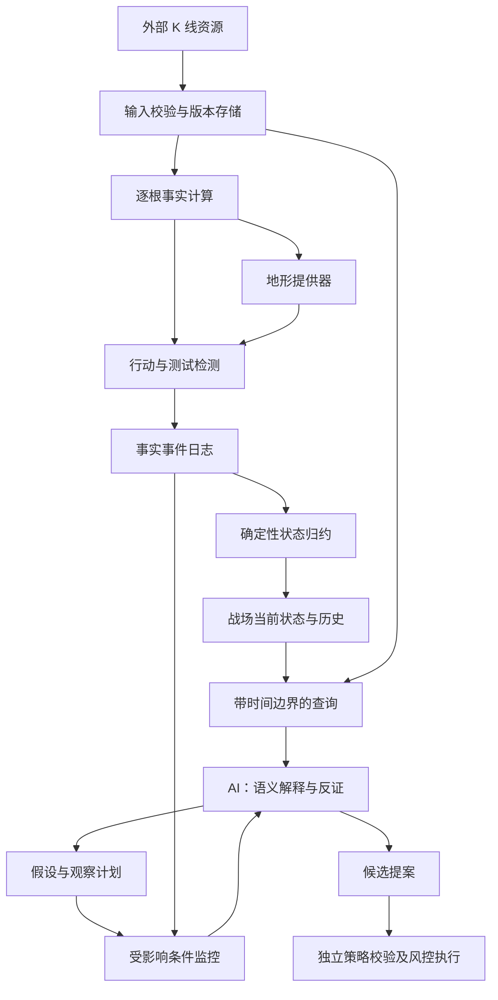

# 虚拟战场翻译器完整实施方案 v1

日期：2026-10-31。状态：待实现的编码与评估基线。关联《虚拟战场市场状态模型设计-v1.md》《纯数据价格行为判读对齐方案-v1.md》《缺口主体系自动交易改造方案-v1.md》。本文件细化行情到战场的翻译过程，不改变自动交易优化 v2.2 的账户风险与执行权限。

## 1. 一句话定义

K 线是战场加载资源，多空是两个方向的参与方，价格区域是地形，推进与回撤是行动，突破与收回是结果。翻译器把它们组织成可查询、可回放、可核验的状态和事件；AI 解释局势、维护假设、提出观察计划。

这是一种价格行为的表达模型，不是实际撮合仿真。每笔成交同时有买卖双方；阳线不等于真实多军人数增加，阴线不等于资金撤退。系统只记录可观察结果，不制造兵力、弹药、机构意图、真实被套仓位或“胜率分数”。

目标不是把每根 K 线硬译成一句战争故事，而是让局部过程和跨过程关系完整可追溯。原始数据保留，摘要可以展开；事实未知必须表达 unknown。

## 2. 成功标准与首版边界

首版：一个标的、一个周期、已收盘 K 线、anchor_separation 缺口、一种 GC1 观察任务。输入来源由外部提供；不开发行情采集、大屏、向量库、微服务或自有模型，不接真实下单。

验收分三层：

- 翻译正确：价格、方向、时序、事件计数可复算，未来数据不改变过去已知状态。
- 表达充分：专家认为影响判断的关键过程能在战场查询中找到，必要时能展开原始区间。
- 判读有效：AI 仅查战场时，相对直接读取完整数据的基线，不因摘要遗漏而增加错误放行或漏判。

收益属于策略与执行评估，不是翻译正确的证明。相同解释也不要求相同交易：等待、取消和候选必须由冻结策略限定。

## 3. 系统组成



翻译内核不调用模型。AI 可以提出位置或替代分段，但不能直接改写事实；提案进入独立候选层，核验引用后才可参与后续观察。历史不可因模型意见重写。

## 4. 战场词汇与数据边界

| 战场名称 | 内部对象/事实                  | 不允许推断          |
| ---- | ------------------------ | -------------- |
| 两军   | up/down 两个方向的行动记录        | 真实参与者身份、资金量或人数 |
| 地形   | Level：价格线/区域及来源          | 已被市场认可的唯一支撑阻力  |
| 推进   | Advance：相对于固定起点的价格扩展     | 所有上涨均由主动买盘造成   |
| 防守反应 | Response：触及区域后的收回/停滞/反推  | 已知该位置挂单数量      |
| 突破尝试 | Attempt：越过冻结边界           | 突破已成功或必然失败     |
| 成果保持 | 持续收外、回吐程度等独立指标           | 固定根数自动等同有效突破   |
| 战线争夺 | Contest：同位置附近双向事件序列      | 按一次穿越就转换真实控制权  |
| 缺口阵地 | Gap：规则定义下的分离结构           | 实际成交真空或已知被套库存  |
| 目标区域 | Target：事前可计算的投影/结构       | 未来必须到达         |
| 战役判断 | Hypothesis：趋势、区间、恢复或反转解释 | 确定性事实或自动交易许可   |

界面可以使用战场比喻；模型和数据库使用上述中性对象名，避免拟人化叙事替代证据。

## 5. 原始资源契约

```text
Bar: id, symbol, timeframe, open_time, close_time,
     open, high, low, close, source, received_at, data_revision
Snapshot: id, cutoff_at, observed_until, bar_refs, completeness, content_hash
```

OHLC 满足 low<=min(open,close)<=max(open,close)<=high。价格用 Decimal 字符串，UTC 时间，稳定 bar_id=source/symbol/timeframe/open_time。缺周期、异常价格、重复和修订分开处理。

同版本重复 bar 幂等忽略；同 ID 不同价格记录修订，隔离到重建流程。缺根时不跨缺口认定连续跟随或二次测试；数据恢复后显式重建，不触发历史订单。零振幅可存在，相关比率为 null，不填零伪装无影线。

首版每次只接收新完成的 bar。盘中 stop/limit 成交由执行系统处理，不用已收盘事件模拟逐笔真实路径。

## 6. 翻译层级与算法

### 6.1 单根观察：不急着命名强弱

计算 range、signed_body、body_ratio、close_location、上下影线、与前根的重叠及收盘变化。归一化尺度使用该根之前最多 20 根已收盘 range 的中位数；不足 20 根标 warmup，尺度为零返回 null。该尺度是工程表示政策，不是交易阈值。

绝对价格和相对值并存；算法版本固定。不得用最终全窗口波动率重新评价早期动作。强 K、弱 K 标签不在这一层生成。

### 6.2 地形：位置必须先存在

首版位置来源：审定的人工样板锚、已有算法的确认摆动点、已建立缺口锚与明确计算的目标。全部携带 source_available_at、confirmed_at、生成方法。

摆动确认若需要右侧 K 线，available_at 必须晚于该极值 bar，不能把极值发生时间当确认时间。当前才发现的位置不能回溯制造真实前向事件。

原始边界 lo/hi 与观察带 watch_lo/watch_hi 分开。观察带生成政策随 Level 冻结；更改边界生成新版本，不移动旧战役的判定标准。

机器生成的位置是规则候选，不自动“真”。AI 可提出原始 bar 极值等新位置，由程序核验来源，仍标 model_proposed。无位置时允许低频查询完整行情发现新结构。

### 6.3 动作：先相对位置，再关联过程

动作使用事件器 v1 的 touch、越界、收外、收回、separated、返回定义。每个 Attempt 关联一个位置版本和方向，同位置同方向同时最多一个活跃 Attempt。

推进区间不只采用一个 swing 算法的结果。首版至少保留两种视图：机器候选分段、围绕位置事件起止的区间。AI 可提出替代区间，程序返回相同计算，不让它自造价格。

### 6.4 行动结果：记录向量，不汇总力量分

每个区间以固定起点价格 p0、起始尺度 s0、方向 d（up=1/down=-1）计算：

- net_progress = d*(当前 close-p0)。
- favorable_excursion = max(0, 区间内 d*(价格极值-p0))。
- adverse_excursion = max(0, 区间内 -d*(反向价格极值-p0))。
- giveback = favorable_excursion-net_progress；可大于最大推进，不能强制截到 100%。
- giveback_ratio = giveback/favorable_excursion；分母为零返回 null。
- elapsed_bars、平均重叠、收外根数、是否收回、目标是否触及。

p0 为起始 bar 前一根 close；缺前根则区间计算标不足。尺度 s0 在起点冻结，相对值仅用于比较。随着行动展开追加当前结果，不重写先前查询的结果。

“推进更快”只能说明单位根数的位移更大；“防守更强”属于模型解释。不得以某一个向量项直接计算必胜方。

### 6.5 对照：比较相同参照下的行为

compare_actions(A,B) 返回上述向量、原始区间、尺度及可比性标志。不同周期、不同位置或尺度定义不一致时显式警告，不能直接排强弱。

两军视角以两种方式呈现：同位置 up/down 事件序列；固定区间内向上扩展和向下扩展的价格事实。不能因只存在一个方向的已识别行动就把另一方记为力量零。

### 6.6 缺口与目标

GapBook 按已审定 anchor_separation 定义维护。一个锚关闭后再次立账使用新 gap_id。回补测试按完整靠近—离开—返回划分，不按连续几根 near bar 计数。

Target 保存计算公式、锚点、创建时间和 available_at。到达发 TARGET_TOUCHED；后续拒绝/延续是新事件与解释。没有提前注册的目标不能在见到反转后补写成已知关键位。

## 7. 战场状态不是一个总标签

```text
BattlefieldState
  revision, cursor, cutoff_at, data_revision, algorithm_versions
  levels[], gaps[], attempts[], tests[], segments[], targets[]
  directional_activity: {up: evidence_refs[], down: evidence_refs[]}
  contests[]
  active_hypotheses[]             # 与事实对象分区
  watch_plans[]
  unresolved[], data_health
```

Contest 以 level_version 聚合相邻测试和双向越界，保存参与事件；不输出“多军控制率”。是否趋势或区间仍由假设层描述，允许主备假设和 disputed。

每个对象可展开：当前属性 → 修改事件 → 计算输入 → 原始 bar。缺少这一链的对象不得进入候选证据。

## 8. 逐根更新与事件优先级

```python
validate(bar)
previous = repository.load_projection(scope)
facts = compute_facts(previous, bar, config_version)
events = detect_events(previous, facts)
new_state = reduce_events(previous, events)
commands = derive_rechecks_and_cancellations(previous, new_state, events)
repository.commit(expected_revision, events, new_state, commands)
```

全部为可测试的确定性内核；commit 原子写日志、投影和 outbox，冲突重读再处理。检测函数不得修改输入状态。

同根事件是部分有序集合：价格 high/low 不能证明盘中谁先发生。双侧越界都记录并标 intrabar_order_unknown；cancel 与成立同时可见时禁止新入场，沿用现有纪律。旧 gap 同根被补又反弹必须先记已补，不能为保留假设而继续 open。

关键取消和数据健康检查不受模型预算限制。模型任务按 opportunity/revision/snapshot 合并，限流保留 deferred，不能删除事件。

## 9. 时间模型、回放与数据修正

事件同时保存 event_time、confirmed_at、observed_at、sequence。真实查询 `as_known_at(T)` 不得返回确认或观察发生在 T 之后的内容；研究查询 `reconstructed_at(T,revision)` 必须标研究模式。

事件日志不可覆盖；修订追加 correction，保留旧判断。算法升级创建独立 replay_run_id，不能把新事件插回旧生产日志改变当时判断。

快照仅为重放加速，日志才是事实记录。相同版本和事件序列重建得到相同投影哈希。历史重建不发送实时复核或执行命令，只有明确 live 模式才允许派发。

## 10. AI 查询与输出

AI 使用 get_scene、get_changes、get_history、compare_actions/tests、inspect_evidence、read_bars、check_conditions。每次任务绑定 snapshot token，返回完整性和分页状态；不能混合多个时刻的查询结果。

默认摘要至少含：相关位置、开放及刚关闭缺口、活跃尝试、最近测试、目标、取消事件、未确认事项和原假设。摘要不能只展示支持当前方向的事件。

模型输出：read_cursor、引用的对象版本、支持与反证、解释状态、冻结条件结果、行动提案。行动枚举沿用 WATCH / WAIT_BEHAVIOR / PROPOSE_CANDIDATE / CANCEL / INFORMATION_INSUFFICIENT。

模型只能写入假设提案和观察计划提案。程序检查引用与时刻，解释质量用 Gold 验证。模型无写事实、改预算或直接下单权限。API 超时不能记作策略无机会。

## 11. 最小完整翻译样例

固定位置 P1=100、观察带 [99.5,100.5]，全部数值只作测试夹具。先前 close=99。真实策略阈值不由本例导出。

| 时刻 | OHLC                    | 新事实/事件                     | 当时仍不知道什么           |
| -- | ----------------------- | -------------------------- | ------------------ |
| b1 | 99,102,98.8,101.5       | 上破尝试，收外；本根触锚，缺口尚未建立        | 是否能保持分离            |
| b2 | 101.5,103,101,102.5     | 整根位于锚上方，anchor gap G1 建立   | 回调是否能补缺口           |
| b3 | 102.5,102.8,100.2,100.4 | 首次进入观察带，未触锚，T1 开始          | 是否已被拒绝             |
| b4 | 100.8,102.5,100.7,102.2 | 整根离开观察带；若样板冻结此代理，T1 拒绝此时确认 | 下一次是否独立返回          |
| b5 | 102.2,102.4,100.3,100.4 | 返回观察带，T2 开始；最低价高于 T1       | 第二次拒绝尚未确认          |
| b6 | 100.8,103,100.7,102.8   | 再次整根离开；T2 拒绝按样板代理确认        | 是否满足策略触发、当前位置资格及空间 |

“整根离开即确认拒绝”在这里是具名工程代理政策，不自动等同于专家定义。AI 必须仍可质疑两次测试的解释。b6 不产生订单：后续策略与 gate 必须单独检查。

分支夹具：若 b5 改为 low=99.8，则 G1 触锚关闭；即使随后 close=103，也不能记录“二次未补”。两段剧情共享前缀，系统在 b4 前必须输出完全相同状态。

## 12. 数据库与模块边界

建议 Python 模块：battlefield/contracts.py、facts.py、terrain.py、actions.py、reducers.py、queries.py、repository.py；复用已审定 perception 计算，不另写同义算法。judge 下增加战场任务适配，eval 下增加翻译轨迹和对齐评分。

PostgreSQL 表：events、objects、projection_cursors、hypotheses、watch_plans、query_runs；共享 snapshots、jobs、outbox。约束：event_id 唯一，object_id/revision 唯一，事件消费键幂等，更新采用 expected_revision。

离线样板可使用内存 repository；持久影子使用事务存储。资金、订单、成交不进入本模块写权限。schema 和算法版本随每个事件落库。

## 13. 现有项目迁移

1. 保留当前研究脚本和历史报告，新增 translator 入口，不原地改变历史 gap 含义。
2. 修正缺口历史均幅、锚可见时间及测试计数问题，建立因果夹具。
3. 将通用触及/越界函数从实验采样流程提取，在线不继承每点一次/间隔采样限制。
4. 接入语义卡与 PA-IR；战场是该表示的持久运行形式，不另造第二套字段。
5. 先使用 GC1 观察，不晋升混合方向的旧 G1。地图位置资格阻断独立落账，不在翻译器放宽。
6. 完成纯数据对齐和战场查询对照后，再接 DecisionService 影子；订单语义修复及执行安全另按 v2.2。

若新版 waits 尚未核验，先核对实际字段和状态再迁移；不按旧报告假定已经实现或完全缺失。

## 14. 实施任务与验收产物

| 任务        | 依赖                | 产物                         | 验收                    |
| --------- | ----------------- | -------------------------- | --------------------- |
| W01 翻译规范  | 无                 | 对象词汇、缺口定义、代理政策、样板轨迹        | 专家能逐条找到图上依据           |
| W02 单根事实  | W01               | 公式与边界测试                    | Decimal、零振幅、因果尺度、数据缺失 |
| W03 地形与动作 | W02               | 位置可见时间、Attempt/Test/Gap 事件 | 不提前立账、不误计二测、同根不虚构路径   |
| W04 状态内核  | W03               | reducer、事件重放、投影            | 前缀不变性、幂等、修订分流         |
| W05 查询层   | W04               | 七类查询及快照绑定                  | 完整性、分页、证据展开、未来访问拒绝    |
| W06 AI 判读 | W05               | 单模型查询任务、假设/观察契约            | 不能写事实、引用核验、反证完整       |
| W07 持久影子  | W04,W06           | PostgreSQL/outbox、恢复与限流    | 重启一致、迟到拒绝、取消优先        |
| W08 对齐评估  | W01 起可标注，运行依赖 W06 | 专家 Gold、直接数据与查询组报告         | 质量与成本分别报告             |

每项交付需附输入夹具、预期事件/状态、实际结果与差异。禁止以“提示词写完”代替验收。

## 15. 评估如何证明翻译有效

第一套测试测程序：第 11 节及镜像、无突破、双侧突破、已补后反弹、连续带内、缺根、迟到、重复、修订、冷启动等。

第二套测表达：专家只看相同截止的图与已知历史，列出影响判断的信息；检查战场能否查询到，区分缺事实、缺关系、分段不合适和解释分歧。不能让专家看未来后要求系统提前知道。

第三套测 AI：固定模型、策略、数据截止和历史状态，对比直接 PA-IR 输入与战场查询。分别记录事实错误、序列错误、行动集合一致、候选召回、错误放行、unknown、token 与时延。每题重复运行，重复结果不是独立市场样本。

开发/保留案例按行情段隔离，替代分段及语义卡检索不得泄漏保留集。预算与质量门槛沿用对齐方案并在运行前冻结；查询组若因漏问重要事件表现差，属于系统问题，需要改默认摘要/接口，不只是责怪模型。

## 16. 防偏移规则与待定项

不可变约束：事实与假设分栏；无未来引用；无虚构兵力；无隐藏力量分；未知不等于零；两次调用不等于二测；事件成立不等于成交；模型不能改事实或风险；历史重放不触发实时订单。

W01 前冻结：缺口类别、观察带、测试代理、可接受的专家解释范围。W07 前配置：查询范围/预算、模型任务并发、unknown policy、数据新鲜度和恢复策略。未配置时对应模式启动失败，不让模型补默认值。

不承诺一个状态机涵盖所有阿布判断。先验证样板轨迹，再覆盖更多结构；新术语必须有证据表达、反例与独立验收。地形和过程不足时允许展开原始数据，而不是把不适合的行情硬塞进故事。

## 17. 最终交付形态

用户给出一个标的、周期和时间，系统可以回答：当时有哪些地形；多空各自发生了哪些可观察行动；哪些推进保持、哪些被收回；缺口和目标经历什么变化；哪些解释尚未确定；当前观察计划在等什么。

任何一句回答都能展开到对象、事件、原始 K 线和当时可见时间。AI 可换，状态仍在；解释可争论，事实可核验。这是虚拟战场翻译器的最终验收标准。

## 18. 实时战场可视化

### 18.1 目的与实现顺序

可视化正式纳入交付范围，用于观察局势、核验翻译与解释、重放历史。它读取与 AI 查询相同的对象、事件和版本，不在前端另写一套缺口或攻守识别算法。

前文“不开发大屏”指不先建设复杂展示系统，不排除本节的最小可视化。先完成 W04/W05 的状态与查询契约，再增加薄界面；不以动画或两军装饰替代事实核验。

### 18.2 四块主界面

| 区域    | 内容                              | 交互                              |
| ----- | ------------------------------- | ------------------------------- |
| 主图    | 同截止时刻的 K 线、关键区域、开放缺口、目标、突破与测试标记 | 点击对象定位证据；按类型隐藏图层                |
| 行动时间线 | 突破、收回、缺口建立/回补、测试开始/结束、目标触及      | 点击事件定位关联 K 线与对象版本               |
| 当前假设  | 主备解释、支持、反证、状态和模型评估时间            | 展开证据与修订历史；标明 challenged/unknown |
| 观察计划  | 对象位置、等待行为、已满足与缺失条件、取消条件         | 查看冻结策略条款和最近复核结果                 |

图层优先级：当前选中的机会与相关对象默认显示，其余可折叠；必须显示隐藏对象数量或明确过滤范围。数据缺口、失败任务和取消事件不可因“只看活跃机会”而被静默掩盖。

两军对照展示向上/向下推进的距离、耗时、回吐和收外事实，并列来源区间；不显示虚构兵力、士气或未经校准的胜率。模型提出的位置使用不同线型并标 model_proposed，不能与规则位置混成同一可信级别。

### 18.3 唯一状态来源与读接口

前端复用 W05 的 get_scene/get_changes/get_history/inspect_evidence/read_bars；展示可有聚合接口，但不得改变字段语义。AI 与页面同一 snapshot token 下读取到的价格、gap 状态、测试计数和条件结果必须一致。

每个视图绑定 symbol、timeframe、cutoff、state_revision、data_revision。图表与侧栏必须使用相同 token，更新时整批替换；请求乱序到达不得用旧响应覆盖新版本。

建议首版 HTTP 快照加可配置轮询，不引入 WebSocket 基础设施。轮询只读状态，不触发模型调用。增量接口使用 cursor 分页；cursor 失效或发现缺口时重新取一致性快照，不跳过事件。后续只有延迟测量证明需要时再改为 SSE/WebSocket。

### 18.4 实时更新口径

首版实时表示已收盘 K 线到达后更新，不承诺逐笔行情速度。页面分别显示：

- 最新行情 close_time 与 received_at。
- 战场事实投影 processed_at 与 state_revision。
- AI 当前复核状态 queued/running/completed/failed/held，以及其 read_cursor、cutoff。

新事实已到而 AI 尚未复核时，保留旧解释并显式标“基于旧快照，待复核”，不把它涂成最新判断。复核失败显示错误状态，不能显示为“无交易机会”。数据超时或缺失显示 data_health；页面不能替后端解除暂停。

未来盘中扩展必须独立标 provisional，不覆盖已收盘 confirmed 对象；本版不实现该扩展。

### 18.5 历史回放

提供明确的 LIVE / AS_KNOWN / RECONSTRUCTED 三种模式。LIVE 跟随最新状态；AS_KNOWN 使用当时已知记录；RECONSTRUCTED 显示指定数据和算法版本重建结果。两种历史模式禁止混入后来才生成的 AI 解释。


用户进入历史模式后，新实时数据不改变屏幕时间点；显示“返回实时”按钮。选中事件时可查看 event_time、confirmed_at、observed_at，说明事件发生与系统确认的区别。回放不创建模型任务或执行命令。

### 18.6 证据钻取与人工批注

点击假设或条件后依次展开：语义卡/策略版本 → 引用对象与事件 → 计算值、公式和算法版本 → 原始 K 线。主图同步高亮真正引用的 bar_id；不存在或不可见的引用显示错误，不能定位到最近 K 线充数。

人工批注独立保存为 annotation，含作者、时间、snapshot_id 与说明，不改写事实或自动修改 Gold。首版界面只读加批注，不提供交易按钮或解除风控操作；未来控制能力独立设计权限。

### 18.7 技术范围与交付

新增 W09：最小战场可视化，依赖 W04/W05，可与 W06 并行。若仓库已有前端则复用；没有则采用薄 TypeScript 页面与支持标记/区域的 K 线图组件，具体库按接入时能力和许可核验后选定。本方案不引入 Three.js、游戏引擎或复杂动画。

交付包括四块界面、对象选择、图层过滤、三种时间模式、证据钻取、更新时间和错误显示。首版以单标的单周期验收，不同时扩多屏指挥中心。

### 18.8 可视化验收

1. 同 snapshot token 下，页面与 AI 查询的 gap 状态、价格、测试计数完全一致。
2. 点击 T1/T2 分别高亮正确区间，不能把复核次数画成测试次数。
3. 新行情已处理而 AI 尚未完成时，旧解释有明确陈旧标记。
4. 乱序网络响应不能回退当前状态；断线恢复后完整补齐或重新取快照。
5. 回放 b4 时不得出现 b5/b6 或后来的解释；当时已知与重建模式显式区分。
6. 人工批注、模型假设、确定性事实在视觉上可区分；批注不改变事实状态。
7. 点击任何判断可追溯证据；缺引用不伪装成功定位。
8. 历史浏览、图层切换、轮询不会触发下单或无意新增模型调用。
9. 数据缺口、API 失败、unknown 和策略等待分别展示，不能统一写成 no_trade。
10. 明确显示当前范围、版本与更新时间；不生成无依据的兵力值、控制率或胜率条。

## 19. 产品形态：价格行为战略沙盘

### 19.1 产品定位

将本系统呈现为游戏化的“价格行为战略沙盘”：真实行情推进战场，AI 作为参谋解释变化，用户观察、推演和复盘。沙盘是同一市场状态模型的交互表达，不是独立模拟市场，也不修改行情生成戏剧性结果。

采用“K 线主图＋沙盘表达层”，位置和行动始终锚定真实时间与价格坐标。原始 K 线可随时显示；不以抽象地图替换价格依据。游戏化用于帮助理解过程，不用虚构兵力或单一胜负值代替分析。

### 19.2 沙盘元素与真实对象映射

| 表现元素 | 真实来源 | 点击后展示 |
|---|---|---|
| 地形/据点 | Level、Gap、事前 Target | 边界、来源、可见时间、定义版本 |
| 双方行动箭头 | Segment/Attempt 的已发生路径 | 起止 bar、推进/回撤数值及原始区间 |
| 争夺标记 | Contest 与双向测试事件 | 双方事件，不伪造控制权比例 |
| 战役时间线 | 有序事件及其确认时间 | 行情发生、确认和系统观察时间 |
| 参谋简报 | AI Hypothesis | 支持、反证、未知项、读取快照和修订原因 |
| 作战计划卡 | WatchPlan 与冻结策略条件 | 观察位置、等待行为、触发、取消、当前缺项 |
| 战后记录 | 决策、规则检查、模拟或实际执行记录 | 判断质量、纪律、执行偏差与结果分栏 |

已发生行动用实线；模型假设路径如需绘制必须用虚线并标“假设”，不能伪装成未来行情或预测概率。默认只绘制已发生行动，首版不做自动生成的未来运动动画。

据点“被测试、越界、收回”有事实状态；“被攻占”若使用，必须明确对应哪一条已发布解释规则，并标为假设，首版不默认使用。不能用上下颜色替代文本与图例，保证颜色不可辨时仍能理解方向。

### 19.3 三种产品模式

本节模式是用户任务；§18 的 LIVE/AS_KNOWN/RECONSTRUCTED 是数据时间口径，两者不能混为一个枚举。

**实时观战（首版）**

使用 LIVE 状态。每根收盘后更新地形与事件；AI 异步提交简报。用户可以选择计划、展开变化、查看为什么等待。界面显示计划状态，不提供真实下单按钮。

**历史推演（首版）**

用户选择冻结行情轨迹，未来数据隐藏；按一根或下一已确认事件推进。每个时刻可记录用户判断并查看 AI 在相同可见边界下的判断，之后再推进。允许暂停和返回已揭示历史，但不把已看过未来的再次作答算独立盲测。

历史推演使用独立 session_id、run_id、revealed_until 和 scenario_version；服务端限制所有行情、事件、工具和模型输入不得越过 revealed_until。前端隐藏未来不够，禁止预取未来 K 线、目标反应或后生成标签到客户端。

若使用已存模型结果，必须验证原结果的输入截止不晚于当前揭示时间且策略版本一致。否则重新发起明确的推演任务或显示“该时刻无可用判断”，不能借用后来的简报。

**战后复盘（后续）**

结束后揭示后续行情，比较原计划与实际过程，分别评价证据、必要条件、纪律、执行及结果。首版已有事件日志和批注可用，但完整复盘评分界面另列 W11，不夹带进 W09/W10。

### 19.4 首版交互闭环

1. 选择实时观战或一个冻结历史场景。
2. 查看当前据点、缺口、目标和最近行动；明确哪些来自事实、规则候选或模型假设。
3. 选择作战计划卡，查看四段链与证据位置。
4. 实时等新收盘或推演点击“推进一根/下一事件”。
5. 对变化做短暂高亮，时间线追加记录；没有新证据时不制造战况描述。
6. 查看 AI 简报是否更新；可记录自己的判断与批注。
7. 推演结束保存完整轨迹，后续复盘可重现当时状态。

首版只做轻量标记和变化高亮，不引入游戏引擎、三维场景、军队移动模拟或物理碰撞。动画可关闭，不能阻止读取、改变事件时序或隐去原始价格。

### 19.5 评价与游戏化边界

可以展示学习进度、已复核案例、证据定位准确率和纪律遵守情况；任何评分必须注明标注来源、分母、规则版本和争议状态。未有专家 Gold 的案例只展示记录，不伪造正确答案或由 AI 自评发奖。

不以交易次数、杠杆、冒险程度、连续盈利或单笔收益奖励用户。合规亏损与违规盈利必须能分别表达，等待和取消可以是正确行动。暂不设计综合“战力分”、排行榜或刺激频繁交易的任务。

场景已提前看过、重复作答、专家有争议分别标记，不能混入首次盲测成绩。复盘发现错误可添加裁定版本，但保留当时判断及原评分依据。

### 19.6 与开发任务衔接

- W09 按 §18 实现实时可视化，同时采用本节据点、行动、参谋简报和计划卡表达。
- 新增 W10 历史推演，依赖 W04/W05/W09：服务端揭示边界、逐步推进、独立 session、判断记录及重放恢复。
- 新增 W11 战后复盘，依赖 W08/W10：冻结判断与结果比较、Gold/争议展示和纪律评分；属于首版后的增量。

W09/W10 为首版产品范围；底层事实、状态和查询验收仍优先，不能以沙盘效果代替 W01–W08 的正确性验证。

### 19.7 新增验收

1. 每个据点、箭头和计划卡都有可追溯对象 ID；没有价格来源的装饰不能被误认成分析结论。
2. 假设与已发生路径明显区分，用户能够切回纯 K 线视图。
3. 推演中前端和模型工具都不能取得 revealed_until 之后的数据，包含缓存、分页、对象历史和 AI 简报。
4. “下一事件”仅揭示推进目标时刻已经可确认的事件，不能提前显示事后才能确认的失败/成功标签。
5. 推演请求不写 live 状态，不产生真实订单或实时观察计划副作用。
6. 断线恢复重建相同 session 的揭示位置与已保存判断；重复点击推进不能重复计分或跳过未记录步骤。
7. 返回已揭示历史不重新算首次盲测；重开场景明确标记已见。
8. 未有 Gold、Gold 有争议或模型失败的案例，不显示确定性胜负评价。
9. 游戏化界面仍完整显示数据陈旧、未知、等待与取消，不为叙事连贯而隐藏问题。
10. 关闭动画不影响任何业务功能；图形方向可通过文字/线型辨认，不仅依赖颜色。
